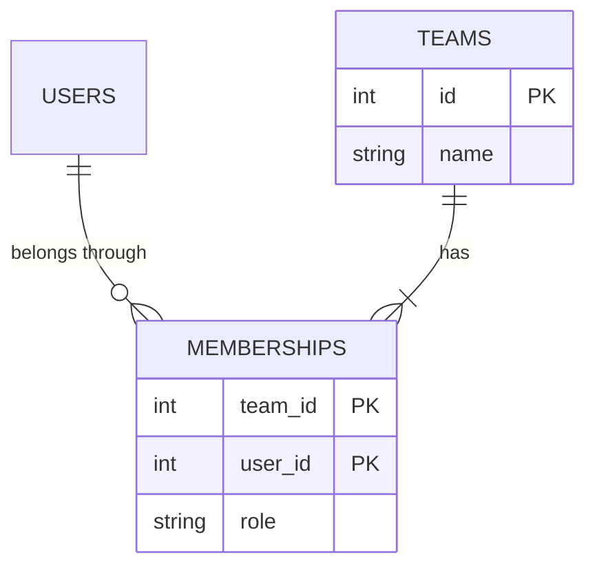
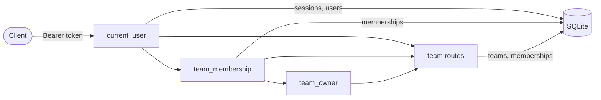

# PRD-015: teamtasks teams and membership

**Status**: Draft
**Date**: 2026-10-25
**Author**: AI-assisted
**Priority**: P1
**Depends on**: None
**Supersedes**: None

> **Pilot note.** This is change 2 of the specforge v2 pilot, built with the v1 workflow so it can be compared with the v2 changes. It is the first PRD against `teamtasks`, so it also creates that sibling's `SYSTEM_ARTIFACT.md`. Logging was cut from this PRD at the step 6 escalation and moved to [PRD-016](016-teamtasks-team-audit-log.md).

## Impacted Projects

| Project | Impact |
|---------|--------|
| **teamtasks** | New tables `teams` (new) and `memberships` (new); new endpoints `POST /teams`, `GET /teams`, `GET /teams/{team_id}/members`, `POST /teams/{team_id}/members`, `DELETE /teams/{team_id}/members/{user_id}` (all new); the bearer-token lookup in `GET /me` extracted into a dependency `current_user` (new), with `team_membership` (new) and `team_owner` (new) built on it; the engine created with `hide_parameters=True`; new `docs/SYSTEM_ARTIFACT.md` (new) |

---

## 1. Problem Statement

A `teamtasks` user can register and log in (`../specforge-pilot/teamtasks/app.py:61-103`), but there is nothing to belong to. The product's scope is team task management (`../specforge-pilot/CLAUDE.md:3`), and every later feature in the pilot backlog — tasks, roles, export — needs a team that holds them and a membership that says who may see them.

There is no usage evidence: the product has no users outside the pilot, and this PRD exists because the pilot backlog orders it second. What is established is the current code (one `users` table, one `sessions` table, an inline token check in `/me`). What is assumed is that one owner per team and a flat member list are enough until the roles PRD.

## 2. Goals

- When a logged-in user creates a team, the system shall make them its owner and its first member, in one transaction.
- When a team's owner adds a registered user by email, the system shall make that user a member.
- When a member lists their teams, the system shall return every team they belong to and their role in each, and no other team.
- When a member lists a team's members, the system shall return each member's id, email and role.
- When the owner removes a member, or a member removes themselves, the system shall end that membership and the removed user's access to the team; the owner cannot be removed.
- If a caller is not a member of a team, then the system shall answer `404` for every route on that team, as if it did not exist.

**Appetite**: one implementation round of the v1 team, under 7 USD of model cost and about 200 lines of product code. A design that needs more is a sign this PRD took in the roles PRD's scope.

## 3. Non-Goals

- **Roles beyond owner and member.** Admins, viewers and per-permission grants are the roles PRD (pilot change 4).
- **Transferring ownership or deleting a team.** Each needs a rule for what happens to the team's tasks, which do not exist yet.
- **Invitations or consent to membership.** Adding a member is immediate; the risks this leaves are accepted in §8 rows 6 and 7.
- **Logging team events and refusals.** Cut at the step 6 escalation; [PRD-016](016-teamtasks-team-audit-log.md) adds it.
- **Unique team names.** Teams are identified by id.

## 4. User Flows / Design

1. The actor is a logged-in user holding a bearer token from `POST /sessions` (`../specforge-pilot/teamtasks/app.py:77-88`). They see JSON responses; there is no UI.
2. Every route answers synchronously in one request; none hashes a password, so none approaches the 25 ms a login takes today.
3. Success is the status code and the body in §5; the member list after an add or a removal shows the change.
4. No design exists; this PRD adds no user interface.

```mermaid
sequenceDiagram
    participant O as Owner
    participant M as Member
    participant API as teamtasks
    participant DB as SQLite

    O->>API: POST /teams {name}
    API->>DB: INSERT teams, INSERT memberships (owner), one commit
    API-->>O: 201 {id, name, role: owner}
    O->>API: POST /teams/{id}/members {email}
    API->>DB: SELECT users WHERE email; INSERT memberships (member)
    API-->>O: 201 {user_id, email, role: member}
    M->>API: GET /teams
    API-->>M: 200 [{id, name, role: member}]
    M->>API: DELETE /teams/{id}/members/{own id}
    API->>DB: DELETE memberships
    API-->>M: 204
```

### 4.1 Happy path

1. The owner calls `POST /teams` with a name; the team and the owner's membership are written in one transaction.
2. The owner calls `POST /teams/{team_id}/members` with a registered user's email; a member row is written.
3. Either of them calls `GET /teams` and sees the team with their role; `GET /teams/{team_id}/members` lists both.
4. The owner removes the member with `DELETE /teams/{team_id}/members/{user_id}`, or the member removes themselves the same way; the removed user then gets `404` on the team and no longer sees it in `GET /teams`.

### 4.2 Error branches

| # | Branch | Status | Body |
|---|--------|--------|------|
| 1 | No token, a malformed `Authorization` header, or an unknown token, on any route | 401 | `{"detail": "invalid token"}` |
| 2 | Team name empty after trimming, over 100 characters, or containing a control or bidi character (§5.1) | 422 | FastAPI validation error |
| 3 | Caller is not a member of the team, or the team does not exist | 404 | `{"detail": "team not found"}` |
| 4 | A member who is not the owner adds a member, whatever the body | 403 | `{"detail": "only the owner can add members"}` |
| 5 | Add-member email is not registered | 404 | `{"detail": "user not found"}` |
| 6 | Add-member email is already a member, including the owner's own email and two concurrent adds of the same email | 409 | `{"detail": "already a member"}` |
| 7 | A member who is not the owner removes someone other than themselves, who is a member and not the owner | 403 | `{"detail": "only the owner can remove other members"}` |
| 8 | The owner is the target of a removal, by anyone | 409 | `{"detail": "the owner cannot be removed"}` |
| 9 | The removal target is not a member of the team | 404 | `{"detail": "member not found"}` |
| 10 | The reverse path: a removed member is added again | 201 | as an ordinary add |
| 11 | The actor stops mid-flow: every route is one transaction, so there is nothing half-written to come back to | — | — |
| 12 | The SQLite file is locked or the membership insert fails during `POST /teams` | 500 | FastAPI's default; the transaction rolls back, so no team is written without its owner's membership (§9 row 17) |
| 13 | A body carries a field the model does not declare, such as `role` | 422 | `extra_forbidden` |
| 14 | A `team_id` or `user_id` that is not an integer, or outside 1 to 2^63-1 | 422 | FastAPI validation error, after authentication; a `team_id` before the team lookup, a `user_id` after it, so a non-member gets 404 whatever the `user_id` |
| 15 | A body declared as JSON that is not valid JSON, or whose bytes are not valid UTF-8 | 422 or 400 | FastAPI's defaults (`json_invalid`, or `There was an error parsing the body`), returned before authentication |

## Frontend Spec

No design exists: this PRD adds no user-visible screen. The product has no UI yet; every surface is the JSON API in §5.

## 5. API

Every route requires `Authorization: Bearer <token>`, resolved by `current_user` (new), the dependency extracted from `GET /me` (`../specforge-pilot/teamtasks/app.py:90-103`). A missing, malformed or unknown token is `401 {"detail": "invalid token"}`, the same as `/me` today. The one exception is a route with a body: FastAPI decodes the body before any dependency runs, so a body that is not valid JSON is `422` and one whose bytes are not valid UTF-8 is `400`, with or without a token (§4.2 branch 15). No route has a rate limit; see §8.

Path ids are one type, `TeamId` (new) and `UserId` (new), each `Annotated[int, Path(ge=1, le=2**63-1)]`, so an out-of-range or non-integer id is `422` instead of a `500` from the SQLite binding. A `team_id` is validated by `team_membership` (new), after authentication and before the team lookup; a `user_id` is a parameter of the route, which FastAPI validates after the dependencies have run, so it is checked after the team lookup. Every new request model sets `extra="forbid"`; `Credentials` and `Login` (`../specforge-pilot/teamtasks/app.py:34-42`) are not changed.

### 5.1 `POST /teams`

**Auth**: any logged-in user, enforced by `current_user` (new).

**Request**: `{"name": "Platform"}` — `name` is `Annotated[str, StringConstraints(strip_whitespace=True, min_length=1, max_length=100)]` (new), and a validator rejects any character whose `unicodedata.category` is `Cc` and the bidi controls U+061C, U+200E, U+200F, U+2028, U+2029, U+202A-U+202E, U+2066-U+2069. Other format characters, such as the zero-width joiner in emoji, are allowed.

**Response 201**: `{"id": 1, "name": "Platform", "role": "owner"}`, with `name` as stored, trimmed.

**Errors**:

| Status | Cause | Client sees |
|--------|-------|-------------|
| 400 | body bytes not valid UTF-8, before authentication | `There was an error parsing the body` |
| 401 | missing or invalid token | `invalid token` |
| 422 | `name` empty after trimming, over 100 characters, or with a rejected character; a field other than `name`; a body that is not valid JSON | validation error |

### 5.2 `GET /teams`

**Auth**: any logged-in user, enforced by `current_user` (new); the query reads only the caller's rows in `memberships`.

**Response 200**: `[{"id": 1, "name": "Platform", "role": "owner"}]`, ordered by team id; `[]` when the caller belongs to none.

**Errors**:

| Status | Cause | Client sees |
|--------|-------|-------------|
| 401 | missing or invalid token | `invalid token` |

### 5.3 `GET /teams/{team_id}/members`

**Auth**: members of the team only, enforced by `team_membership` (new), which loads the caller's membership row for `(team_id, caller)` in one query and answers 404 when there is none.

**Response 200**: `[{"user_id": 1, "email": "ana@example.com", "role": "owner"}, {"user_id": 2, "email": "ben@example.com", "role": "member"}]`, ordered by user id.

**Errors**:

| Status | Cause | Client sees |
|--------|-------|-------------|
| 401 | missing or invalid token | `invalid token` |
| 404 | caller not a member, or no such team | `team not found` |
| 422 | `team_id` not an integer or out of range | validation error |

### 5.4 `POST /teams/{team_id}/members`

**Auth**: the team's owner only, enforced by `team_owner` (new), a dependency built on `team_membership` (new) that answers 403 for a member who is not the owner.

**Request**: `{"email": "ben@example.com"}` — a new request model with `extra="forbid"`, the email pattern of `Credentials.email` (`../specforge-pilot/teamtasks/app.py:36`) and `max_length=254`; the email is trimmed and lower-cased as registration does (`../specforge-pilot/teamtasks/app.py:65`). `role` is never read from the request: add-member always writes `member`.

**Order of checks**: 401 → 422 `team_id` → 404 team not found → 403 not owner → 422 body → 404 user not found → 409 already a member → 201. Because the owner check is a dependency, it runs before the body is validated, so a non-owner gets 403 whatever they send, and never reaches the email lookup.

**Response 201**: `{"user_id": 2, "email": "ben@example.com", "role": "member"}`

**Errors**:

| Status | Cause | Client sees |
|--------|-------|-------------|
| 400 | body bytes not valid UTF-8, before authentication | `There was an error parsing the body` |
| 401 | missing or invalid token | `invalid token` |
| 403 | caller is a member, not the owner | `only the owner can add members` |
| 404 | caller not a member, or no such team | `team not found` |
| 404 | email not registered | `user not found` |
| 409 | email already a member, the owner's own email, or a concurrent add won the race | `already a member` |
| 422 | email malformed or over 254 characters; a field other than `email`; `team_id` out of range; a body that is not valid JSON | validation error |

### 5.5 `DELETE /teams/{team_id}/members/{user_id}`

**Auth**: the owner for any member; any member for themselves. `team_membership` (new) for membership, then the rule in the route; the route has no body, so every check runs in this order.

**Order of checks**: 401 → 422 `team_id` → 404 team not found → 422 `user_id` → 404 member not found → 409 owner target → 403 caller neither the owner nor the target → 204. The delete is scoped by both `team_id` and `user_id`.

**Response 204**: no body.

**Errors**:

| Status | Cause | Client sees |
|--------|-------|-------------|
| 401 | missing or invalid token | `invalid token` |
| 403 | caller is not the owner and the target is another member | `only the owner can remove other members` |
| 404 | caller not a member, or no such team | `team not found` |
| 404 | target is not a member | `member not found` |
| 409 | target is the owner | `the owner cannot be removed` |
| 422 | `team_id` or `user_id` not an integer or out of range | validation error |

## 6. Data Model

Two new tables, created by `Base.metadata.create_all` (`../specforge-pilot/teamtasks/app.py:54`) like the existing ones; `users` (`../specforge-pilot/teamtasks/app.py:17-23`) is only read. No existing table gains a column, so the archived contract's rule that Alembic arrives with the first change altering an existing table does not fire here.



### 6.1 `teams` (new)

| Column | Type | Nullable | Default | Description |
|--------|------|----------|---------|-------------|
| `id` (new) | integer | no | autoincrement | primary key |
| `name` (new) | varchar(100) | no | — | trimmed, 1-100 characters, no control or bidi character; not unique |

The owner is not stored on `teams`: `memberships.role` is the one source of ownership.

### 6.2 `memberships` (new)

| Column | Type | Nullable | Default | Description |
|--------|------|----------|---------|-------------|
| `team_id` (new) | integer | no | — | FK to `teams.id`; part of the primary key |
| `user_id` (new) | integer | no | — | FK to `users.id` (`../specforge-pilot/teamtasks/app.py:20`); part of the primary key |
| `role` (new) | varchar(10) | no | — | `owner` or `member`, enforced by `CheckConstraint("role IN ('owner','member')")` (new) |

**Indexes**:

- the composite primary key `(team_id, user_id)`;
- `uq_memberships_one_owner` (new), unique on `team_id` where `role = 'owner'` (`sqlite_where`), so a team has at most one owner row;
- `ix_memberships_user_id` (new) on `user_id`, for `GET /teams`, which the primary key cannot serve because it leads with `team_id`.

**Uniqueness**: the primary key makes a second membership for the same user impossible. Two concurrent adds of the same email race on that key; the loser's insert raises `IntegrityError` and is answered `409`, the pattern registration already uses (`../specforge-pilot/teamtasks/app.py:73-74`).

**Foreign keys** are declared but not enforced: SQLite enforces them only with `PRAGMA foreign_keys=ON`, which the app does not set. That is harmless here, because only routes holding valid ids insert rows; the first PRD that deletes users or teams must not assume cascades.

**How a row leaves**: a `memberships` row is deleted by §5.5. A `teams` row never leaves in this PRD. Existing rows: none, both tables are new.

## 7. Architecture

One component, the FastAPI app built by `create_app` (`../specforge-pilot/teamtasks/app.py:52`), and its SQLite file. The app owns all new state; nothing else reads it.



- `current_user` (new) is the bearer-token lookup now inline in `GET /me` (`../specforge-pilot/teamtasks/app.py:90-103`), moved into a FastAPI dependency that `GET /me` and every team route use.
- `team_membership` (new) loads the caller's row in `memberships` for the path's `team_id` and raises `404 team not found` when there is none, so a non-member cannot tell a missing team from a team they are not in. `team_owner` (new) builds on it and raises 403 for a role other than `owner`.
- The three dependencies are closures inside `create_app`, because `engine` is local to it (`../specforge-pilot/teamtasks/app.py:53`). Each opens and closes its own `Session(engine)` and returns plain values — the user's id and email, the caller's role — never ORM instances. Each route opens its own `Session(engine)`, as the existing ones do (`../specforge-pilot/teamtasks/app.py:69`).
- `POST /teams` writes the team and the owner's membership in one session and one `commit()`. Add-member runs a `SELECT` on the existing membership (→ 409) and also catches `IntegrityError` around `commit()` (→ 409) for the race.
- The engine is created with `hide_parameters=True` (new) at `../specforge-pilot/teamtasks/app.py:53`, so a database error's traceback, which uvicorn writes to stderr, never carries an email bound as a SQL parameter.

**Rejected**: copying the token check into each route — five copies of an authentication check is five places to get it wrong. **Rejected**: `teams.owner_id` beside `memberships.role` — two sources of ownership that can disagree, and the roles PRD would have to rewrite both. **Rejected**: the owner check inside the route — FastAPI validates the body first, so a non-owner with a bad body would get 422 instead of 403. **Rejected**: one request-scoped session shared by the dependencies and the route — it would work, but it breaks the per-route `Session(engine)` convention the app already follows (`../specforge-pilot/teamtasks/app.py:69`); reconsider it if a route needs the dependency's rows inside its own transaction. Reconsider the single-file layout when `teamtasks/app.py` passes about 400 lines.

## 8. Security

| # | Threat | Mitigation | Enforced at |
|---|--------|------------|-------------|
| 1 | An unauthenticated caller reads or changes teams | every route depends on `current_user` (new), the same check `/me` does today | `current_user` (new), extracted from `../specforge-pilot/teamtasks/app.py:90-103` |
| 2 | A user reads another team's members or learns it exists | `team_membership` (new) answers 404 for a non-member, with the same status, body and single query as for a missing team | `team_membership` (new) |
| 3 | A member adds or removes others | `team_owner` (new) answers 403 before the body is read; a member may only remove themselves | `team_owner` (new), §5.5 (new) |
| 4 | A client grants itself ownership | `role` is never read from a request; every new request model sets `extra="forbid"`, so a body with `role` is 422; a second owner row is refused by `uq_memberships_one_owner` (new) | §5.4, §6.2 (new) |
| 5 | A team ends up with no owner | the owner's membership cannot be deleted (§4.2 branch 8) | §5.5 (new) |
| 6 | **Accepted risk, re-confirmed by the human on 2026-10-25 with the corrected premise:** add-member answers `404 user not found` for an unregistered email, so any registered user — anyone can create a team and become its owner with one call — can learn whether an email is registered. It is a cheaper and quieter oracle than `POST /users` (`../specforge-pilot/teamtasks/app.py:73-74`): no scrypt per probe, and no account created by a miss | the order of checks keeps non-owners of a team off it (§5.4); closing it needs invitations, a future PRD | — |
| 7 | **Accepted risk, decided by the human on 2026-10-25:** membership needs no consent. An owner can add any registered email; members then see each other's emails (§5.3) without having agreed, and a user who leaves can be added again indefinitely, under a team name the owner chose | none in this PRD; invitations or an accept step would close it | — |
| 8 | Input reaches storage | `name` is length-bounded, trimmed and stripped of control and bidi characters; `email` is pattern-checked and capped at 254; both are bound as SQLAlchemy parameters | §5.1, §5.4 (new) |
| 9 | An email reaches the log through a database error | the engine is created with `hide_parameters=True`, so uvicorn's traceback of an `OperationalError` shows SQLAlchemy's hidden-parameters marker instead of the bound email | `../specforge-pilot/teamtasks/app.py:53` |
| 10 | A path id the database cannot bind | `TeamId`/`UserId` (new) bound ids to 1..2^63-1, so an oversized id is 422 rather than a 500 | §5 (new) |
| 11 | Abuse by volume | no rate limit, in line with the rest of the app; the sandbox has no public deployment. A real deployment needs one on every authenticated route | — |
| 12 | A stolen token | inherited: tokens never expire and there is no logout (archived register-and-login contract, Out), so every new route accepts a stolen token indefinitely; the roles PRD should not build on that unknowingly | — |

**Secrets**: none new. **PII**: emails, shown only to members of the same team by §5.3 and §5.4.

## 9. Test Plan

| # | Test | Type | Description | Path |
|---|------|------|-------------|------|
| 1 | creating a team returns 201 with role owner, and the creator is its only member | integration | Reads `memberships` to check exactly one row, role `owner`. | `../specforge-pilot/tests/test_teams.py` |
| 2 | team name boundaries | integration | 100 characters is 201; 101 is 422; 100 plus surrounding spaces is 201 with the trimmed name returned; whitespace only, missing, `null` and a non-string are 422; a 100-character multibyte name is 201; `"a\u009bb"`, `"a‏b"` and `"a\u0007b"` are 422. | `../specforge-pilot/tests/test_teams.py` |
| 3 | every team route without a token, with a malformed header or with an unknown token is 401 | integration | Parametrised over the five routes. | `../specforge-pilot/tests/test_teams.py` |
| 4 | `GET /teams` returns exactly the caller's teams with their role, and `[]` for a user in none | integration | Fails against a list that returns every team in the table. | `../specforge-pilot/tests/test_teams.py` |
| 5 | the owner adds a registered user by email, in any letter case, and the member list shows them with role `member` | integration | The email is sent as `  BEN@Example.com ` and listed lower-cased. | `../specforge-pilot/tests/test_teams.py` |
| 6 | adding an unregistered email is 404 `user not found`; a malformed email and one over 254 characters are 422 | integration | 254 characters is accepted, 255 is 422. | `../specforge-pilot/tests/test_teams.py` |
| 7 | adding someone already a member is 409, and so is the owner adding their own email | integration | Fails against an add-member with neither the membership `SELECT` nor `except IntegrityError`, which answers 500. | `../specforge-pilot/tests/test_teams.py` |
| 8 | a member who is not the owner gets 403 adding an unregistered email, and 403 with a malformed body | integration | Fails against an owner check made after the email lookup or after body validation. | `../specforge-pilot/tests/test_teams.py` |
| 9 | a non-member gets 404 on every route of a team, identical to a team id that does not exist | integration | Fails against a check that answers 403 for an existing team, which tells a probing user the team exists. | `../specforge-pilot/tests/test_teams.py` |
| 10 | after the owner removes a member (204), the removed user gets 404 on the team, no longer sees it in `GET /teams`, and their token still works on `/me` | integration | Fails against a removal that leaves the membership readable. | `../specforge-pilot/tests/test_teams.py` |
| 11 | a member removes themselves (204) with the same after-effects as row 10; a member removing another member is 403 | integration | | `../specforge-pilot/tests/test_teams.py` |
| 12 | removing the owner is 409, by the owner and by a member | integration | Pins the §5.5 order: a member targeting the owner gets 409, not 403. | `../specforge-pilot/tests/test_teams.py` |
| 13 | removing a user who is not a member is 404 `member not found`, by the owner and by a member | integration | Pins the §5.5 order: 404 member not found comes before 403. | `../specforge-pilot/tests/test_teams.py` |
| 14 | a removed member can be added again | integration | 201, and the member list shows them once. | `../specforge-pilot/tests/test_teams.py` |
| 15 | `GET /me` still returns the user after the token check moves into `current_user` | integration | A deliberate overlap with `../specforge-pilot/tests/test_auth.py:90-95`, kept in this suite as the regression for the extraction. | `../specforge-pilot/tests/test_teams.py` |
| 16 | a database error on the add-member email lookup does not put the email in the traceback | integration | A `before_cursor_execute` listener on the app's engine raises `sqlite3.OperationalError("database is locked")` for the add-member lookup only — the statement whose compiled text filters `users` by `email` (`WHERE users.email = ?`). `current_user` also selects `users.email`, but joins `sessions` and filters by token hash, so the listener keys on that `WHERE` text, not on a generic `users`/`email` substring, and the test asserts the caught exception's statement is that lookup; the test calls add-member with `raise_server_exceptions=True` inside `pytest.raises(sqlalchemy.exc.OperationalError)`, builds the email at runtime, and asserts the email is absent from `"".join(traceback.format_exception(exc))` and SQLAlchemy's hidden-parameters marker is present. Fails against `create_engine` without `hide_parameters`. | `../specforge-pilot/tests/test_teams.py` |
| 17 | a failing membership insert during `POST /teams` leaves no team | integration | A `BEFORE INSERT ON memberships` trigger raising `ABORT` is created on the test database; with `raise_server_exceptions=False` the response is 500 and `teams` has 0 rows. Fails against a route that commits the team before the membership. | `../specforge-pilot/tests/test_teams.py` |
| 18 | a concurrent add of the same email is 409 | integration | A one-shot `before_flush` listener on `Session`, removed in `finally`, inserts the same membership through a raw sqlite3 connection; the add answers 409. Fails against a route without `except IntegrityError` (500). | `../specforge-pilot/tests/test_teams.py` |
| 19 | add-member with `"role": "owner"` in the body is 422 and writes no membership | integration | Fails against a route that copies `role` from the body, and against a model that ignores extra fields. | `../specforge-pilot/tests/test_teams.py` |
| 20 | the database refuses a second owner row and an unknown role | integration | Raw sqlite3 inserts with a fresh `(team_id, user_id)` pair: a second `owner` for a team raises `IntegrityError` (the partial unique index), and `role='admin'` raises `IntegrityError` (the CHECK). A repeat of the existing pair would hit the primary key first and pass against a schema with neither. | `../specforge-pilot/tests/test_teams.py` |
| 21 | an out-of-range or non-integer path id | integration | `/teams/0/members`, `/teams/99999999999999999999/members` and `/teams/abc/members` are 401 without a token and 422 with one; `DELETE /teams/1/members/abc` is 422 for a member and 404 for a non-member. Fails against path ids typed as plain `int`, where the oversized id raises `OverflowError` in the SQLite binding and answers 500. | `../specforge-pilot/tests/test_teams.py` |
| 22 | `GET /teams` is served by `ix_memberships_user_id` | conformance | `EXPLAIN QUERY PLAN` on the route's query names the index. Fails against a schema whose only index is the primary key. | `../specforge-pilot/tests/test_teams.py` |
| 23 | an undecodable body on `POST /teams` and on add-member is answered before authentication | integration | Without a token: `{bad` with `content-type: application/json` is 422, and the bytes `{"email":"\xff"}` are 400 `There was an error parsing the body`, on both routes. Pins §4.2 branch 15 so a later change of order is seen. | `../specforge-pilot/tests/test_teams.py` |
| 24 | removing a member from one team leaves their membership in another | integration | ben is a plain member of teams A and B, which have different owners; A's owner removes ben; ben's row for B is still in `memberships` and ben still sees B in `GET /teams`. Fails against a delete scoped by `user_id` alone, which removes ben from every team. | `../specforge-pilot/tests/test_teams.py` |

## 10. Migration Plan

1. Deploy the app. `create_all` (`../specforge-pilot/teamtasks/app.py:54`) creates `teams`, `memberships`, the CHECK constraint and both indexes on startup; it needs only the existing `users` table, which it already creates. Rollback: deploy the previous commit; the two tables stay unused.
**Rollback**: step 1 can be rolled back at any time; dropping `memberships` then `teams` removes the feature's data, and nothing else references them.

Existing rows: none in the two new tables; `users` and `sessions` are untouched. No backfill. No feature flag: the routes are new and unused until a client calls them.

## Observability

This PRD logs nothing new; team events and refusals are logged by [PRD-016](016-teamtasks-team-audit-log.md). Until then:

- on success and on refusal, no line is written; the status code is the only signal, and uvicorn's access log, written to stderr, records each request's method, path and status;
- a `500` is written by uvicorn to stderr as a traceback, which carries no email (§8 row 9);
- the number that would show probing — 404 `team not found` or `user not found` per caller per hour — cannot be computed from the access log, which does not name the caller. The cost is that probing team ids and emails goes unseen; PRD-016 owns the signal and its reader.

## 11. Open Questions

- [ ] Probing of team ids and emails is invisible until PRD-016 ships. Cost: the accepted risks in §8 rows 6 and 7 cannot be watched. Owned by PRD-016.
- [ ] A registered email may carry bidi or control characters (the pattern at `../specforge-pilot/teamtasks/app.py:36` allows them), and §5.3 now shows emails to other members, where one can render misleadingly. Cost: spoofed member lists. Owned by a change to registration, which this PRD leaves untouched.
- [ ] No rate limit on authenticated routes (§8 row 11). Cost: unbounded probing by a logged-in user. Owned by a future rate-limiting change.

## Clarifications

- 2026-10-25 — What does add-member answer for an unregistered email? → §8 row 6.
- 2026-10-25 — With the attacker set corrected to any registered user, keep the email oracle and membership without consent? → §8 rows 6 and 7.
- 2026-10-25 — How to close two fixes refuted after their one re-proposal (log-injection test, body-parse clause)? → Non-Goals and Observability (logging cut to PRD-016); §4.2 branch 15.

---

## Gate: Promotion to Implemented

```yaml
commit_hash: [TBD]
tests:
  - [TBD]
system_artifact_diff:
  - [TBD]
```
