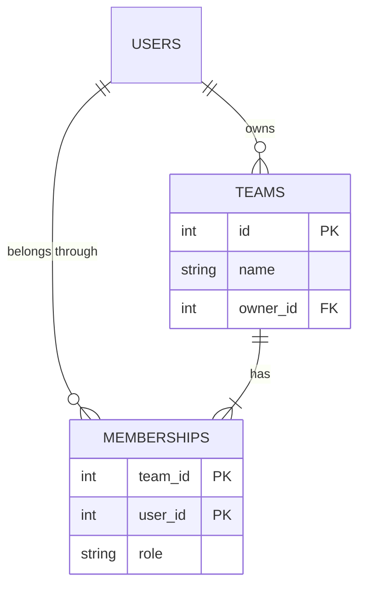
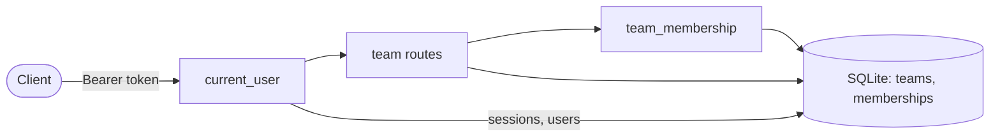

# PRD-015: teamtasks teams and membership

**Status**: Draft
**Date**: 2026-10-25
**Author**: AI-assisted
**Priority**: P1
**Depends on**: None
**Supersedes**: None

> **Pilot note.** This is change 2 of the specforge v2 pilot, built with the v1 workflow so it can be compared with the v2 changes. It is the first PRD against `teamtasks`, so it also creates that sibling's `SYSTEM_ARTIFACT.md`.

## Impacted Projects

| Project | Impact |
|---------|--------|
| **teamtasks** | New tables `teams` (new) and `memberships` (new); new endpoints `POST /teams`, `GET /teams`, `GET /teams/{team_id}/members`, `POST /teams/{team_id}/members`, `DELETE /teams/{team_id}/members/{user_id}` (all new); the bearer-token lookup in `GET /me` extracted into a shared dependency `current_user` (new); new `docs/SYSTEM_ARTIFACT.md` (new) |

---

## 1. Problem Statement

A `teamtasks` user can register and log in (`../specforge-pilot/teamtasks/app.py:61-103`), but there is nothing to belong to. The product's scope is team task management (`../specforge-pilot/CLAUDE.md:3`), and every later feature in the pilot backlog — tasks, roles, export — needs a team that holds them and a membership that says who may see them.

There is no usage evidence: the product has no users outside the pilot, and this PRD exists because the pilot backlog orders it second. What is established is the current code (one `users` table, one `sessions` table, an inline token check in `/me`). What is assumed is that one owner per team and a flat member list are enough until the roles PRD.

## 2. Goals

- When a logged-in user creates a team, the system shall make them its owner and its first member.
- When a team's owner adds a registered user by email, the system shall make that user a member.
- When a member lists their teams, the system shall return every team they belong to and their role in each, and no other team.
- When a member lists a team's members, the system shall return each member's id, email and role.
- When the owner removes a member, or a member removes themselves, the system shall end that membership; the owner cannot be removed.
- If a caller is not a member of a team, then the system shall answer `404` for every route on that team, as if it did not exist.

**Appetite**: one implementation round of the v1 team, under 7 USD of model cost and about 150 lines of product code. A design that needs more is a sign this PRD took in the roles PRD's scope.

## 3. Non-Goals

- **Roles beyond owner and member.** Admins, viewers and per-permission grants are the roles PRD (pilot change 4).
- **Transferring ownership or deleting a team.** Each needs a rule for what happens to the team's tasks, which do not exist yet.
- **Invitations.** Adding a member is immediate; invitations would add a pending state and an acceptance flow.
- **Hiding whether an email is registered on add-member.** Accepted as a risk in §8; `POST /users` already reveals it.
- **Unique team names.** Teams are identified by id.

## 4. User Flows / Design

1. The actor is a logged-in user holding a bearer token from `POST /sessions` (`../specforge-pilot/teamtasks/app.py:77-88`). They see JSON responses; there is no UI.
2. Every route answers synchronously in one request, under the 25 ms a login takes today (scrypt dominates that; these routes do no hashing).
3. Success is the status code and the body in §5; the member list after an add or a removal shows the change.
4. No design exists; this PRD adds no user interface.

```mermaid
sequenceDiagram
    participant O as Owner
    participant M as Member
    participant API as teamtasks
    participant DB as SQLite

    O->>API: POST /teams {name}
    API->>DB: INSERT teams, INSERT memberships (owner)
    API-->>O: 201 {id, name, role: owner}
    O->>API: POST /teams/{id}/members {email}
    API->>DB: SELECT users WHERE email; INSERT memberships (member)
    API-->>O: 201 {user_id, email, role: member}
    M->>API: GET /teams
    API-->>M: 200 [{id, name, role: member}]
    M->>API: DELETE /teams/{id}/members/{own id}
    API->>DB: DELETE memberships
    API-->>M: 204
```

### 4.1 Happy path

1. The owner calls `POST /teams` with a name; the team and the owner's membership are written in one transaction.
2. The owner calls `POST /teams/{team_id}/members` with a registered user's email; a member row is written.
3. Either of them calls `GET /teams` and sees the team with their role; `GET /teams/{team_id}/members` lists both.
4. The owner removes the member with `DELETE /teams/{team_id}/members/{user_id}`, or the member removes themselves the same way.

### 4.2 Error branches

| # | Branch | Status | Body |
|---|--------|--------|------|
| 1 | No token, a malformed `Authorization` header, or an unknown token, on any route | 401 | `{"detail": "invalid token"}` |
| 2 | Team name empty after trimming, or longer than 100 characters | 422 | FastAPI validation error |
| 3 | Caller is not a member of the team, or the team does not exist | 404 | `{"detail": "team not found"}` |
| 4 | A member who is not the owner adds a member | 403 | `{"detail": "only the owner can add members"}` |
| 5 | Add-member email is not registered | 404 | `{"detail": "user not found"}` |
| 6 | Add-member email is already a member, including two concurrent adds of the same email | 409 | `{"detail": "already a member"}` |
| 7 | A member who is not the owner removes someone other than themselves | 403 | `{"detail": "only the owner can remove other members"}` |
| 8 | The owner is the target of a removal, by anyone | 409 | `{"detail": "the owner cannot be removed"}` |
| 9 | The removal target is not a member of the team | 404 | `{"detail": "member not found"}` |
| 10 | The reverse path: a removed member is added again | 201 | as an ordinary add |
| 11 | The actor stops mid-flow: every route is one transaction, so there is nothing half-written to come back to | — | — |
| 12 | The SQLite file is locked by another writer or cannot be written | 500 | FastAPI's default; the transaction rolls back, so a team is never written without its owner's membership |

## Frontend Spec

No design exists: this PRD adds no user-visible screen. The product has no UI yet; every surface is the JSON API in §5.

## 5. API

Every route below requires `Authorization: Bearer <token>`, resolved by `current_user` (new), the dependency extracted from `GET /me` (`../specforge-pilot/teamtasks/app.py:90-103`). A missing, malformed or unknown token is `401 {"detail": "invalid token"}` on every route, the same as `/me` today. No route has a rate limit; see §8.

### 5.1 `POST /teams`

**Auth**: any logged-in user, enforced by `current_user` (new).

**Request**: `{"name": "Platform"}` — `name` is trimmed, then 1-100 characters.

**Response 201**: `{"id": 1, "name": "Platform", "role": "owner"}`

**Errors**:

| Status | Cause | Client sees |
|--------|-------|-------------|
| 401 | missing or invalid token | `invalid token` |
| 422 | `name` empty after trimming, or over 100 characters | validation error |

### 5.2 `GET /teams`

**Auth**: any logged-in user, enforced by `current_user` (new); the query is filtered to the caller's memberships.

**Response 200**: `[{"id": 1, "name": "Platform", "role": "owner"}]`, ordered by team id; `[]` when the caller belongs to none.

**Errors**:

| Status | Cause | Client sees |
|--------|-------|-------------|
| 401 | missing or invalid token | `invalid token` |

### 5.3 `GET /teams/{team_id}/members`

**Auth**: members of the team only, enforced by `team_membership` (new), which loads the caller's membership row and answers 404 when there is none.

**Response 200**: `[{"user_id": 1, "email": "ana@example.com", "role": "owner"}, {"user_id": 2, "email": "ben@example.com", "role": "member"}]`, ordered by user id.

**Errors**:

| Status | Cause | Client sees |
|--------|-------|-------------|
| 401 | missing or invalid token | `invalid token` |
| 404 | caller not a member, or no such team | `team not found` |

### 5.4 `POST /teams/{team_id}/members`

**Auth**: the team's owner only: `team_membership` (new) for membership, then a role check in the route.

**Request**: `{"email": "ben@example.com"}` — validated with the pattern on `Credentials.email` (`../specforge-pilot/teamtasks/app.py:36`), then trimmed and lower-cased as registration does (`../specforge-pilot/teamtasks/app.py:65`).

**Response 201**: `{"user_id": 2, "email": "ben@example.com", "role": "member"}`

**Errors**:

| Status | Cause | Client sees |
|--------|-------|-------------|
| 401 | missing or invalid token | `invalid token` |
| 403 | caller is a member, not the owner | `only the owner can add members` |
| 404 | caller not a member, or no such team | `team not found` |
| 404 | email not registered | `user not found` |
| 409 | email already a member, or a concurrent add won the race | `already a member` |
| 422 | email malformed | validation error |

### 5.5 `DELETE /teams/{team_id}/members/{user_id}`

**Auth**: the owner for any member; any member for themselves. `team_membership` (new) for membership, then the rule in the route.

**Response 204**: no body.

**Errors**:

| Status | Cause | Client sees |
|--------|-------|-------------|
| 401 | missing or invalid token | `invalid token` |
| 403 | caller is not the owner and the target is someone else | `only the owner can remove other members` |
| 404 | caller not a member, or no such team | `team not found` |
| 404 | target is not a member | `member not found` |
| 409 | target is the owner | `the owner cannot be removed` |

## 6. Data Model

Two new tables, created by `Base.metadata.create_all` (`../specforge-pilot/teamtasks/app.py:54`) like the existing ones; `users` (`../specforge-pilot/teamtasks/app.py:17-23`) is only read. No existing table gains a column, so the archived contract's rule that Alembic arrives with the first change altering an existing table does not fire here.



### 6.1 `teams` (new)

| Column | Type | Nullable | Default | Description |
|--------|------|----------|---------|-------------|
| `id` (new) | integer | no | autoincrement | primary key |
| `name` (new) | varchar(100) | no | — | trimmed, 1-100 characters; not unique |
| `owner_id` (new) | integer | no | — | FK to `users.id` (`../specforge-pilot/teamtasks/app.py:20`); the creator, never changes in this PRD |

### 6.2 `memberships` (new)

| Column | Type | Nullable | Default | Description |
|--------|------|----------|---------|-------------|
| `team_id` (new) | integer | no | — | FK to `teams.id`; part of the primary key |
| `user_id` (new) | integer | no | — | FK to `users.id`; part of the primary key |
| `role` (new) | varchar(10) | no | — | `owner` or `member`; exactly one `owner` row per team, written with the team |

**Uniqueness**: the composite primary key `(team_id, user_id)` makes a second membership for the same user impossible. Two concurrent adds of the same email race on that key; the loser's insert raises `IntegrityError` and is answered `409`, the pattern registration already uses (`../specforge-pilot/teamtasks/app.py:73-74`).

**How a row leaves**: a `memberships` row is deleted by §5.5. A `teams` row never leaves in this PRD. Existing rows: none, both tables are new.

## 7. Architecture

One component, the FastAPI app built by `create_app` (`../specforge-pilot/teamtasks/app.py:52`), and its SQLite file. Routes are registered inside `create_app` and open `Session(engine)` themselves, like the existing ones (`../specforge-pilot/teamtasks/app.py:69`). The app owns all new state; nothing else reads it.



The bearer-token lookup now inline in `GET /me` (`../specforge-pilot/teamtasks/app.py:90-103`) moves into `current_user` (new), a FastAPI dependency that `GET /me` and every team route use. `team_membership` (new) builds on it: it loads the caller's row in `memberships` for the path's `team_id` and raises `404 team not found` when there is none, so a non-member cannot tell a missing team from a team they are not in.

**Rejected**: copying the token check into each route. Five copies of an authentication check is five places to get it wrong, and the next PRD adds more routes. **Rejected**: a `role` column on `users`. A user is an owner of one team and a member of another; the role belongs to the membership. Reconsider the single-file layout when `teamtasks/app.py` passes about 400 lines.

## 8. Security

| # | Threat | Mitigation | Enforced at |
|---|--------|------------|-------------|
| 1 | An unauthenticated caller reads or changes teams | every route depends on `current_user` (new), the same check `/me` does today | `current_user` (new), extracted from `../specforge-pilot/teamtasks/app.py:90-103` |
| 2 | A user reads another team's members or learns it exists | `team_membership` (new) answers 404 for a non-member, the same as for a missing team | `team_membership` (new) |
| 3 | A member adds or removes others | the route checks the caller's `role` is `owner` before writing; a member may only remove themselves | each of §5.4 and §5.5 (new) |
| 4 | A team ends up with no owner | the owner's membership cannot be deleted (§4.2 branch 8) | §5.5 (new) |
| 5 | Input reaches storage | `name` is length-bounded and stored through SQLAlchemy parameters; `email` is pattern-checked (`../specforge-pilot/teamtasks/app.py:36`) and only used in a parameterised lookup | §5.1, §5.4 (new) |
| 6 | **Accepted risk, decided by the human on 2026-10-25:** add-member answers `404 user not found` for an unregistered email, so a team owner can learn whether an email is registered | bounded to authenticated owners of a team; `POST /users` already reveals registration with its `409` (`../specforge-pilot/teamtasks/app.py:73-74`), so hiding it here alone would not close the leak | — |
| 7 | Abuse by volume | no rate limit, in line with the rest of the app; the sandbox has no public deployment. A real deployment needs one on every authenticated route | — |

**Secrets**: none new. **PII**: emails, shown only to members of the same team by §5.3 and §5.4, and never logged (Observability).

## 9. Test Plan

| # | Test | Type | Description | Path |
|---|------|------|-------------|------|
| 1 | creating a team returns 201 with role owner, and the creator is its only member | integration | | `../specforge-pilot/tests/test_teams.py` |
| 2 | a team name empty after trimming or over 100 characters is 422 | integration | | `../specforge-pilot/tests/test_teams.py` |
| 3 | every team route without a token, with a malformed header or with an unknown token is 401 | integration | | `../specforge-pilot/tests/test_teams.py` |
| 4 | `GET /teams` returns exactly the caller's teams with their role, and `[]` for a user in none | integration | Fails against a list that returns every team in the table. | `../specforge-pilot/tests/test_teams.py` |
| 5 | the owner adds a registered user by email, in any letter case, and the member list shows them | integration | | `../specforge-pilot/tests/test_teams.py` |
| 6 | adding an unregistered email is 404 `user not found`, a malformed email is 422 | integration | | `../specforge-pilot/tests/test_teams.py` |
| 7 | adding someone already a member is 409 | integration | | `../specforge-pilot/tests/test_teams.py` |
| 8 | a member who is not the owner gets 403 adding a member | integration | | `../specforge-pilot/tests/test_teams.py` |
| 9 | a non-member gets 404 on every route of a team, identical to a team id that does not exist | integration | Fails against a check that answers 403 for an existing team, which tells a probing user the team exists. | `../specforge-pilot/tests/test_teams.py` |
| 10 | the owner removes a member (204) and the member list no longer shows them | integration | | `../specforge-pilot/tests/test_teams.py` |
| 11 | a member removes themselves (204); a member removing someone else is 403 | integration | | `../specforge-pilot/tests/test_teams.py` |
| 12 | removing the owner is 409, by the owner or by a member | integration | | `../specforge-pilot/tests/test_teams.py` |
| 13 | removing a user who is not a member is 404 `member not found` | integration | | `../specforge-pilot/tests/test_teams.py` |
| 14 | a removed member can be added again | integration | | `../specforge-pilot/tests/test_teams.py` |
| 15 | `GET /me` still returns the user after the token check moves into `current_user` | integration | Regression for the extraction; the locked `tests/test_auth.py` covers its 401 branches. | `../specforge-pilot/tests/test_teams.py` |
| 16 | no team route writes an email or a token to the log | unit | Fails against a log line that formats the request body or the added user, which would carry the email. | `../specforge-pilot/tests/test_teams.py` |

## 10. Migration Plan

1. Deploy the app. `create_all` (`../specforge-pilot/teamtasks/app.py:54`) creates `teams` and `memberships` on startup; it needs only the existing `users` table, which it already creates. Rollback: deploy the previous commit; the two tables stay unused.
2. The last step that can be rolled back is step 1, at any time: dropping `memberships` then `teams` removes the feature's data and nothing else references them.

Existing rows: none in the two new tables; `users` and `sessions` are untouched. No backfill. No feature flag: the routes are new and unused until a client calls them.

## Observability

The app logs nothing today. This PRD adds a logger `teamtasks` (new) and these lines, at `INFO`, with ids only and never an email or a token:

- success: `team.created team_id=<id> owner_id=<id>`, `member.added team_id=<id> user_id=<id> by=<id>`, `member.removed team_id=<id> user_id=<id> by=<id>`;
- refusal: `team.refused route=<path> status=<403|404|409> user_id=<id> team_id=<id>`.

The number that says something is wrong is `team.refused` with `status=404` per `user_id`: above 20 in an hour, one user is probing team ids. The reader is whoever runs `uv run uvicorn` and reads its stdout; the sandbox has no log store or alarm, so this number is a query run by hand, not an alert (§11).

## 11. Open Questions

- [ ] No alarm reads `team.refused`. Cost of leaving it: probing goes unseen. Closes with the first real deployment, owned by whoever runs it.
- [ ] §4.2 branch 12 (SQLite locked or unwritable) has no §9 row: forcing a locked file in a test is costly, and the claim rests on SQLAlchemy's transaction rollback. Cost: a team written without its owner's membership would go unseen. Closes with a test that commits the team and fails the membership insert.
- [ ] No rate limit on authenticated routes (§8 row 7). Cost: unbounded probing of team ids and emails by a logged-in user. Owned by a future rate-limiting change.

## Clarifications

- 2026-10-25 — What does add-member answer for an unregistered email? → §8 row 6.

---

## Gate: Promotion to Implemented

```yaml
commit_hash: [TBD]
tests:
  - [TBD]
system_artifact_diff:
  - [TBD]
```
