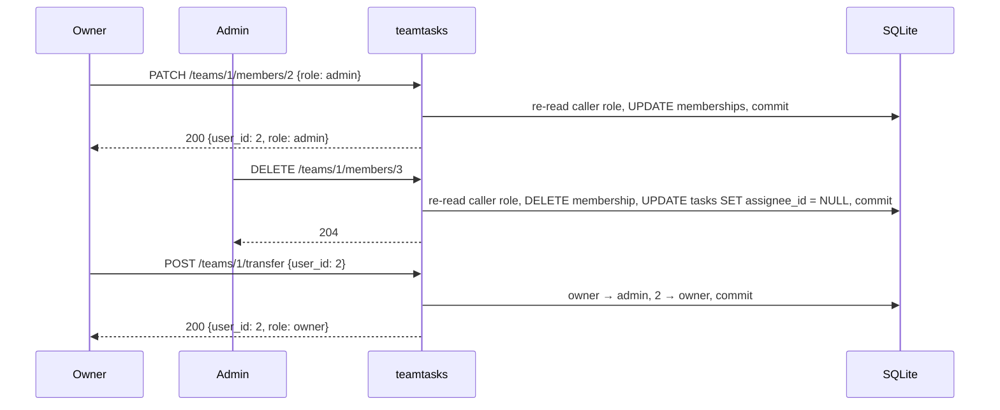
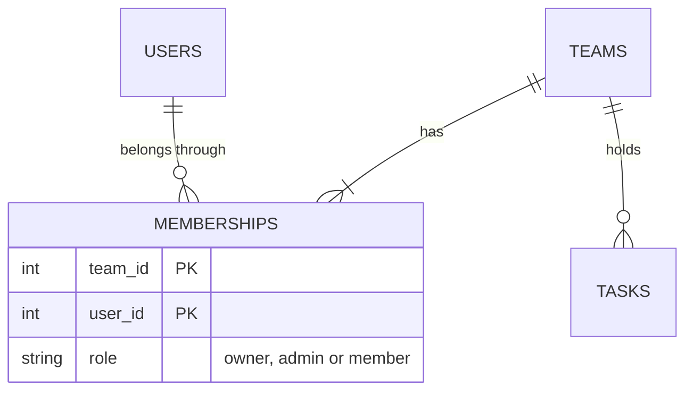
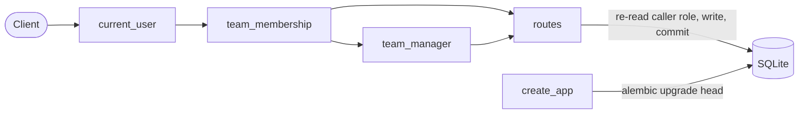

# PRD-017: teamtasks team roles

**Status**: Draft
**Date**: 2026-10-25
**Author**: AI-assisted
**Priority**: P1
**Depends on**: PRD-015
**Supersedes**: PRD-015

> **Pilot note.** Change 4 of the specforge v2 pilot, built with the v1 workflow. It changes who may do what on the routes PRD-015 shipped and the v2 change `2026-10-25-team-tasks` added, so it supersedes PRD-015; PRD-015 stays frozen and is marked `Superseded by PRD-017` when this ships. It is the first change to alter an existing table, so it introduces Alembic.

## Impacted Projects

| Project | Impact |
|---------|--------|
| **teamtasks** | `memberships.role` gains `admin`, through the sibling's first Alembic migrations (new); new endpoints `PATCH /teams/{team_id}/members/{user_id}` (new) and `POST /teams/{team_id}/transfer` (new); changed rules on add-member, remove-member and delete-task; removal unassigns the member's tasks; role checks for writes move inside the route's transaction; `docs/SYSTEM_ARTIFACT.md` teams and tasks domains |

---

## 1. Problem Statement

A team has one owner who does every administrative act alone (`../specforge-pilot/teamtasks/app.py:225-228`, `:285-288`, `:347-348`), and ownership can never change: there is no route to promote anyone or hand the team over. Two debts recorded at earlier ships wait on this change: a removed member stays the assignee of their tasks (`../specforge-pilot/docs/SYSTEM_ARTIFACT.md:165`), and the role check and the route's write run in separate sessions, which "the roles PRD must revisit before roles can change" (`../specforge-pilot/docs/SYSTEM_ARTIFACT.md:120`).

There is no usage evidence; the pilot backlog orders this change fourth. What is established is the code and the two debts. What is assumed is that three roles — owner, admin, member — cover the product until it has real users.

## 2. Goals

- When the owner promotes a member to admin, or demotes an admin to member, the system shall record the new role.
- When the owner transfers ownership to another member, the system shall make that member the owner and the previous owner an admin, in one transaction.
- When an admin or the owner adds a registered user by email, the system shall make them a member.
- When the owner removes anyone but themselves, an admin removes a member, or anyone removes themselves (except the owner), the system shall end that membership and unassign that user's tasks in the team, in one transaction.
- When the owner, an admin or the task's creator deletes a task, the system shall delete it.
- If a caller's role changes between their membership check and their write, then the system shall judge the write by the role at the time of the write.

**Appetite**: one implementation round, under 7 USD, about 250 lines of product code including the migrations. More means this PRD took in invitations or audit logging.

## 3. Non-Goals

- **A read-only viewer role.** Every member can still create and edit tasks.
- **Audit log of role changes.** Nothing is logged; [PRD-016](016-teamtasks-team-audit-log.md) owns it.
- **More than one owner.** Exactly one owner per team, as in PRD-015.
- **Deleting a team.** Unchanged from PRD-015.
- **Changing auth.** Tokens still never expire (PRD-015 §8 row 12).

## 4. User Flows / Design

1. The actors are logged-in users with a bearer token; they see JSON, there is no UI.
2. Every route answers in one request; the migration runs once at startup, before the app serves.
3. Success is the status code and body in §5; `GET /teams/{team_id}/members` shows each member's current role.
4. No design exists; this PRD adds no user interface.



### 4.1 Happy path

1. The owner promotes a member to admin with `PATCH /teams/{team_id}/members/{user_id}`.
2. The admin adds and removes members; a removed member's tasks in the team lose their assignee.
3. The owner transfers ownership with `POST /teams/{team_id}/transfer`; the new owner sees `owner` in `GET /teams`, the previous owner sees `admin`.

### 4.2 Error branches

| # | Branch | Status | Body |
|---|--------|--------|------|
| 1 | No or unknown token, on any route | 401 | `{"detail": "invalid token"}` |
| 2 | Caller not a member of the team | 404 | `{"detail": "team not found"}` |
| 3 | A member (not owner, not admin) adds a member | 403 | `{"detail": "only the owner or an admin can add members"}` |
| 4 | Anyone but the owner changes a role or transfers ownership | 403 | `{"detail": "only the owner can manage roles"}` |
| 5 | Role change or transfer whose target is not a member | 404 | `{"detail": "member not found"}` |
| 6 | Role change whose target is the owner, or whose new role is `owner` | 409 | `{"detail": "use transfer to change the owner"}` |
| 7 | Role change body with a role other than `admin` or `member`, or extra fields | 422 | validation error |
| 8 | Transfer to the owner themselves | 409 | `{"detail": "already the owner"}` |
| 9 | An admin removes another admin, or anyone but the owner removes an admin | 403 | `{"detail": "only the owner can remove an admin"}` |
| 10 | A member removes someone other than themselves | 403 | `{"detail": "only the owner or an admin can remove other members"}` |
| 11 | Anyone removes the owner | 409 | `{"detail": "the owner cannot be removed"}` |
| 12 | A member who is neither the creator deletes a task | 403 | `{"detail": "only the owner, an admin or the creator can delete a task"}` |
| 13 | The caller's role was lowered after their membership check and before their write | the write's own status | judged on the role read inside the write's transaction (§7) |
| 14 | Two transfers of the same team race | one 200, the other 403 | the second re-reads its role inside its transaction and is no longer owner |
| 15 | The migration fails at startup | the app does not start | the previous schema is left as it was (§10) |

## Frontend Spec

No design exists: this PRD adds no user-visible screen; every surface is the JSON API in §5.

## 5. API

Unchanged from PRD-015 unless stated: authentication through `current_user` (`../specforge-pilot/teamtasks/app.py:202-214`), membership through `team_membership` (`../specforge-pilot/teamtasks/app.py:216-223`), the `TeamId`/`UserId` bounds, `extra="forbid"` on every request model, body-parse errors before authentication. Every response that carries a `role` may now carry `admin`.

**Role check inside the write.** Every route that writes and depends on a role — §5.1 to §5.5 — re-reads the caller's membership row inside its own `Session` before writing, and decides on that value, not on the value `team_membership` returned. `team_membership` still answers 404 for a non-member before the body is validated.

### 5.1 `PATCH /teams/{team_id}/members/{user_id}` (new)

**Auth**: the owner only.

**Request**: `{"role": "admin"}` or `{"role": "member"}`.

**Order of checks**: 401 → 422 `team_id` → 404 team not found → 403 not the owner → 422 body → 422 `user_id` → 404 member not found → 409 target is the owner → 200.

**Response 200**: `{"user_id": 2, "email": "ben@example.com", "role": "admin"}`.

**Errors**: 401 `invalid token`; 403 `only the owner can manage roles`; 404 `team not found`, `member not found`; 409 `use transfer to change the owner`; 422 validation error (including `role: "owner"`, which the model rejects — see §4.2 branch 6 for the 409 when the target is the owner).

### 5.2 `POST /teams/{team_id}/transfer` (new)

**Auth**: the owner only.

**Request**: `{"user_id": 2}`, bounded like `UserId`.

**Order of checks**: 401 → 422 `team_id` → 404 team not found → 403 not the owner → 422 body → 404 member not found → 409 already the owner → 200.

**Effect**: in one transaction, the caller's row becomes `admin` and the target's row becomes `owner`. The previous owner's row is updated first, so `uq_memberships_one_owner` never sees two owners.

**Response 200**: `{"user_id": 2, "email": "ben@example.com", "role": "owner"}`.

**Errors**: 401; 403 `only the owner can manage roles`; 404 `team not found`, `member not found`; 409 `already the owner`; 422.

### 5.3 `POST /teams/{team_id}/members` (changed)

**Auth**: the owner or an admin. `team_owner` (`../specforge-pilot/teamtasks/app.py:225-228`) is replaced by `team_manager` (new), which answers 403 `only the owner or an admin can add members` to a member. Everything else — order of checks, 404 `user not found`, 409 `already a member`, `role` always `member` — is unchanged from PRD-015 §5.4.

### 5.4 `DELETE /teams/{team_id}/members/{user_id}` (changed)

**Auth and rule**: the owner removes anyone but themselves; an admin removes members and themselves; a member removes themselves.

**Order of checks**: 401 → 422 `team_id` → 404 team not found → 422 `user_id` → 404 member not found → 409 owner target → 403 (`only the owner can remove an admin` when the target is an admin and the caller is not the owner; `only the owner or an admin can remove other members` when a member targets someone else) → 204.

**Effect**: in one transaction, the membership is deleted and every task in the team with `assignee_id` equal to the removed user is set to `null`.

### 5.5 `DELETE /teams/{team_id}/tasks/{task_id}` (changed)

**Auth**: the owner, an admin, or the task's creator; else 403 `only the owner, an admin or the creator can delete a task`. Order of checks unchanged from change `2026-10-25-team-tasks`.

## 6. Data Model

`memberships.role` accepts a third value. `teams`, `tasks` and the other columns are unchanged.



### 6.1 `memberships` (changed)

| Column | Type | Nullable | Default | Description |
|--------|------|----------|---------|-------------|
| `role` | varchar(10) | no | — | `owner`, `admin` or `member`, enforced by `CHECK (role IN ('owner','admin','member'))`; was `owner` or `member` (`../specforge-pilot/teamtasks/app.py:56`) |

Every existing row holds `owner` or `member` before the migration and keeps it. `uq_memberships_one_owner` and `ix_memberships_user_id` (`../specforge-pilot/teamtasks/app.py:57-58`) are recreated unchanged.

### 6.2 Migrations (new)

- Alembic (`alembic` is already a dependency, `../specforge-pilot/pyproject.toml:8`) with `migrations/` (new) and `alembic.ini` (new) in the sibling root.
- `0001_baseline` (new): the schema as shipped today — `users`, `sessions`, `teams`, `memberships`, `tasks`, their constraints and indexes.
- `0002_admin_role` (new): rebuilds `memberships` with `batch_alter_table(recreate="always")` to change the CHECK, copying every row; SQLite cannot alter a CHECK in place.
- `create_app` (`../specforge-pilot/teamtasks/app.py:164-166`) runs `alembic upgrade head` on its database instead of `Base.metadata.create_all`. A database that has tables but no `alembic_version` — every database created before this PRD — is stamped `0001_baseline` first, then upgraded.

**Uniqueness and races**: unchanged; a transfer updates the previous owner before the new one, so the partial unique index holds at every statement.

## 7. Architecture

One component, the FastAPI app, and its SQLite file.



- `team_manager` (new) replaces `team_owner` and answers 403 for a plain member; it gates add-member before the body is validated, as `team_owner` did.
- **The write's own role read.** PRD-015 §7 rejected a shared request session and left a trigger: "reconsider it if a route needs the dependency's rows inside its own transaction". Changing roles fires it. Rather than share one session across dependencies, each role-sensitive write re-reads the caller's membership inside the route's session and decides on that row; the dependency's value only gates the 404 and the pre-body 403. This closes the gap recorded at `../specforge-pilot/docs/SYSTEM_ARTIFACT.md:120`.
- **Removal unassigns** in the route's transaction: `DELETE memberships` then `UPDATE tasks SET assignee_id = NULL WHERE team_id = ? AND assignee_id = ?`.
- **Migrations replace `create_all`** at startup, so there is one way the schema is made.

**Rejected**: a shared request-scoped session across all dependencies — it would also fix the gap, but every read route would hold a transaction it does not need, and PRD-015's per-route convention would break for one benefit. **Rejected**: keeping `create_all` for new tables and Alembic only for alterations — two ways to make a schema that can disagree. **Rejected**: an `is_admin` boolean beside `role` — two sources of a role, the shape PRD-015 rejected for ownership.

## 8. Security

| # | Threat | Mitigation | Enforced at |
|---|--------|------------|-------------|
| 1 | An admin gives themselves or others more power | only the owner changes roles or transfers; a role body can only carry `admin` or `member` | §5.1, §5.2 (new) |
| 2 | Privilege kept after a demotion or removal | each role-sensitive write re-reads the caller's row inside its own transaction | §7 (new) |
| 3 | A team without an owner, or with two | the owner cannot be removed or demoted; transfer updates both rows in one transaction; `uq_memberships_one_owner` refuses a second owner | §5.1, §5.2, §6.1 |
| 4 | Transfer to a non-member or an outsider | the target must already be a member of the team | §5.2 (new) |
| 5 | A removed member still holds work in the team | their tasks are unassigned in the removal's transaction | §5.4 (changed) |
| 6 | Role and transfer changes are invisible | none in this PRD; [PRD-016](016-teamtasks-team-audit-log.md) owns the audit log | — |
| 7 | Inherited: tokens never expire, the email oracle and membership without consent (PRD-015 §8 rows 6, 7, 12) | unchanged | — |

**Secrets**: none new. **PII**: unchanged; emails as in PRD-015.

## 9. Test Plan

| # | Test | Type | Description | Path |
|---|------|------|-------------|------|
| 1 | the owner promotes a member to admin and demotes them back, and `GET /teams/{team_id}/members` shows each role | integration | | `../specforge-pilot/tests/test_roles.py` |
| 2 | only the owner changes roles: an admin and a member get 403 `only the owner can manage roles` | integration | | `../specforge-pilot/tests/test_roles.py` |
| 3 | a role change on the owner, or to `owner`, is refused | integration | Target the owner: 409 `use transfer to change the owner`; body `{"role": "owner"}`: 422; `{"role": "viewer"}` and extra fields: 422. | `../specforge-pilot/tests/test_roles.py` |
| 4 | a role change whose target is not a member is 404 `member not found` | integration | | `../specforge-pilot/tests/test_roles.py` |
| 5 | transfer makes the target owner and the previous owner admin | integration | Both rows read back from `memberships`; the team still has exactly one owner row. | `../specforge-pilot/tests/test_roles.py` |
| 6 | transfer by a non-owner is 403; to a non-member 404; to the owner themselves 409 `already the owner` | integration | | `../specforge-pilot/tests/test_roles.py` |
| 7 | an admin adds a member; a member adding one gets 403 `only the owner or an admin can add members` | integration | | `../specforge-pilot/tests/test_roles.py` |
| 8 | removal rules by role | integration | The owner removes an admin and a member (204); an admin removes a member (204) and gets 403 `only the owner can remove an admin` on another admin; a member removing another member gets 403; anyone removing the owner gets 409. | `../specforge-pilot/tests/test_roles.py` |
| 9 | removing a member unassigns their tasks in that team and only that team | integration | ben is assignee of a task in A and in B; removing him from A leaves A's task with `assignee_id` null and B's task still his. Fails against a removal that leaves `assignee_id` set, and against one that unassigns in every team. | `../specforge-pilot/tests/test_roles.py` |
| 10 | an admin deletes any task; a member deletes only their own | integration | | `../specforge-pilot/tests/test_roles.py` |
| 11 | a role lowered after the membership check is judged at the write | integration | A one-shot hook demotes the caller (admin → member) between `team_membership` and the write; the admin's removal of a member then answers 403 and the member stays. Fails against a route that trusts the dependency's role. | `../specforge-pilot/tests/test_roles.py` |
| 12 | a database from before this PRD is upgraded in place | integration | A file built with the PRD-015 schema through `create_all`, with an owner and a member, is opened by `create_app`; `alembic_version` is `0002_admin_role`, both rows keep their roles, and promoting the member to `admin` succeeds. Fails against an app that runs `create_all` only, where the old CHECK refuses `admin`. | `../specforge-pilot/tests/test_roles.py` |
| 13 | the schema made by migrations matches the models | conformance | `alembic upgrade head` on an empty file, compared with `Base.metadata` through `alembic.autogenerate.compare_metadata`, reports no difference. | `../specforge-pilot/tests/test_roles.py` |
| 14 | the database refuses an unknown role and a second owner | integration | Raw sqlite3 inserts with fresh `(team_id, user_id)` pairs: `role='viewer'` and a second `owner` both raise `IntegrityError`; `role='admin'` is accepted. | `../specforge-pilot/tests/test_roles.py` |
| 15 | two concurrent transfers leave one owner | integration | The second transfer, started with the old owner's token after the first committed, answers 403 and the team has one owner. | `../specforge-pilot/tests/test_roles.py` |
| 16 | the earlier suites still pass with their role expectations updated per the propagation table | integration | | `../specforge-pilot/tests/test_teams.py` |
| 17 | the task suites still pass with their delete expectations updated per the propagation table | integration | | `../specforge-pilot/tests/test_tasks.py` |
| 18 | the task fix suite still passes with its refused-delete case updated | integration | | `../specforge-pilot/tests/test_tasks_fix.py` |
| 19 | the new routes need a token and bound their ids | integration | `PATCH /teams/{team_id}/members/{user_id}` and `POST /teams/{team_id}/transfer` are 401 without a token or with an unknown one; with a token, a `team_id` or `user_id` of `0` or `99999999999999999999` is 422, never 500; the same for `DELETE /teams/{team_id}/members/{user_id}`. Fails against plain `int` ids, which overflow the SQLite binding. | `../specforge-pilot/tests/test_roles.py` |

### 9.1 Earlier tests whose expectations change

These tests encode PRD-015's and change 3's owner-only rules, which this PRD supersedes. The implementer updates them in the same change; nothing else in them changes. This list is the sites known at authoring time, not a completeness claim; step 9's diff reconciliation covers the rest.

| File(s) | Site | Current | Change |
|---|---|---|---|
| `../specforge-pilot/tests/test_teams.py` | the span `def test_8_non_owner_gets_403_before_body_or_lookup` | asserts the message `only the owner can add members` | assert `only the owner or an admin can add members` |
| `../specforge-pilot/tests/test_teams.py` | the span `def test_11_member_removes_self_but_not_others` | asserts `only the owner can remove other members` | assert `only the owner or an admin can remove other members` |
| `../specforge-pilot/tests/test_teams.py` | the span `def test_20_database_refuses_second_owner_and_unknown_role` | treats `admin` as an unknown role | use `viewer` as the unknown role |
| `../specforge-pilot/tests/test_tasks.py` | the span `def test_9_owner_and_creator_may_delete_another_member_may_not` | asserts `only the owner or the creator can delete a task` | assert `only the owner, an admin or the creator can delete a task` |

## 10. Migration Plan

1. Back up the SQLite file (copy it) before deploying; SQLite has no transactional DDL guarantee across a table rebuild if the process dies.
2. Deploy the app. On startup `create_app` stamps an unversioned database `0001_baseline`, then runs `0002_admin_role`, which rebuilds `memberships` with the new CHECK and recreates its two indexes. Existing rows keep their roles. If the migration fails, the app does not start and the backup is the rollback.
3. After step 2, no other step.

**Rollback**: deploy the previous commit and restore the step 1 backup. `0002_admin_role` has a downgrade, which first demotes every `admin` row to `member` — a data change — then rebuilds the old CHECK; it is for development, and the backup is the production path. Rollback is possible until the first `admin` is created; after that, restoring the backup loses every role change made since.

No backfill. No feature flag.

## Observability

Nothing new is logged; [PRD-016](016-teamtasks-team-audit-log.md) owns team logging. A role change, a transfer and a removal are visible only through `GET /teams/{team_id}/members`. The migration's outcome is visible in uvicorn's stderr at startup (Alembic's `INFO` lines through its own logger) and in `alembic_version`. The number that would say something is wrong — a role change per team per hour — cannot be computed until PRD-016 ships.

## 11. Open Questions

- [ ] Role changes and transfers are unaudited until PRD-016. Cost: an admin's or owner's abuse leaves no trace. Owned by PRD-016.
- [ ] The migration runs at app startup; with more than one process, two could race to migrate. The sandbox runs one. Owned by the first multi-process deployment.

## Clarifications

- 2026-10-25 — Which roles exist and what can each do? → §2, §5, §8 row 1.

---

## Gate: Promotion to Implemented

```yaml
commit_hash: [TBD]
tests:
  - [TBD]
system_artifact_diff:
  - [TBD]
```
