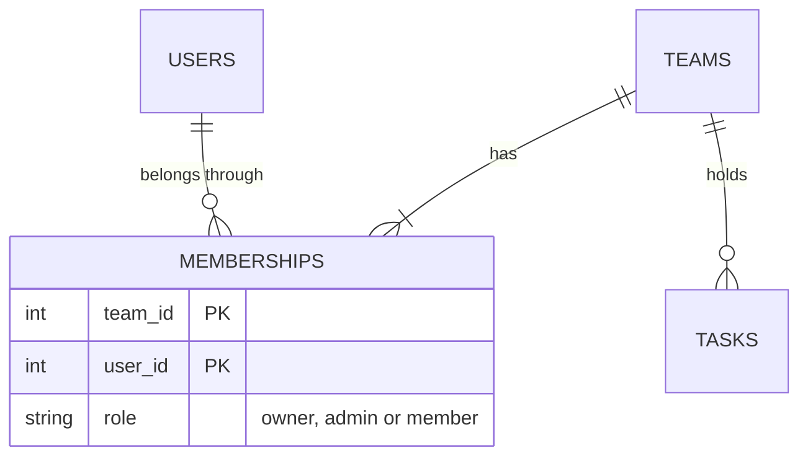
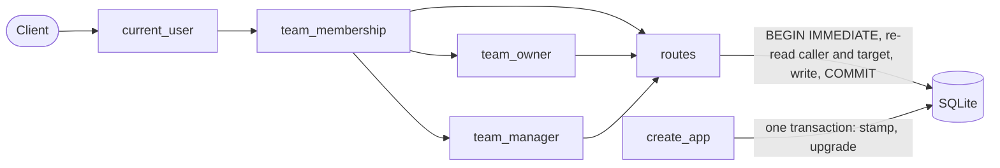

# PRD-017: teamtasks team roles

**Status**: Draft
**Date**: 2026-10-25
**Author**: AI-assisted
**Priority**: P1
**Depends on**: PRD-015
**Supersedes**: PRD-015

> **Pilot note.** Change 4 of the specforge v2 pilot, built with the v1 workflow. It changes who may do what on the routes PRD-015 shipped and the v2 change `2026-10-25-team-tasks` added, so it supersedes PRD-015; PRD-015 stays frozen and is marked `Superseded by PRD-017` when this ships. It is the first change to alter an existing table, so it introduces Alembic.

## Impacted Projects

| Project | Impact |
|---------|--------|
| **teamtasks** | `memberships.role` gains `admin` through the sibling's first Alembic migrations (new); new endpoints `PATCH /teams/{team_id}/members/{user_id}` (new) and `POST /teams/{team_id}/transfer` (new); changed rules on add-member, remove-member and delete-task; removal unassigns the member's tasks; the engine serializes every transaction with `BEGIN IMMEDIATE`; `log_in` hashes outside any session; `tests/conftest.py` (new); `docs/SYSTEM_ARTIFACT.md` teams and tasks domains |

---

## 1. Problem Statement

A team has one owner who does every administrative act alone (`../specforge-pilot/teamtasks/app.py:225-228`, `:285-288`, `:347-348`), and ownership can never change: there is no route to promote anyone or hand the team over. Two debts recorded at earlier ships wait on this change: a removed member stays the assignee of their tasks (`../specforge-pilot/docs/SYSTEM_ARTIFACT.md:165`), and the role check and the route's write run in separate sessions, which "the roles PRD must revisit before roles can change" (`../specforge-pilot/docs/SYSTEM_ARTIFACT.md:120`).

There is no usage evidence; the pilot backlog orders this change fourth. What is established is the code, the two debts, and — measured by two reviewers during this PRD's draft review — that under the sibling's SQLite driver a role read and the write that depends on it are not atomic, so a role change racing a transfer can leave a team with no owner. What is assumed is that three roles cover the product until it has real users.

## 2. Goals

- When the owner promotes a member to admin, or demotes an admin to member, the system shall record the new role.
- When the owner, confirming their password, transfers ownership to another member, the system shall make that member the owner and the previous owner an admin, in one transaction.
- When an admin or the owner adds a registered user by email, the system shall make them a member.
- When anyone but the owner removes themselves, the owner removes anyone but themselves, or an admin removes a plain member, the system shall end that membership and unassign that user's tasks in the team, in one transaction.
- When the owner, an admin or the task's creator deletes a task, the system shall delete it.
- If a caller's or a target's role or membership changes while a request is in flight, then the system shall judge the request's write on the rows as they stand when the write's transaction holds the database lock, so a team always has exactly one owner.

**Appetite**: one implementation round, under 7 USD, about 300 lines of product code including the migrations. More means this PRD took in invitations or audit logging.

## 3. Non-Goals

- **A read-only viewer role.** Every member can still create and edit tasks.
- **Audit log of role changes and transfers.** Nothing is logged; [PRD-016](016-teamtasks-team-audit-log.md) owns it.
- **More than one owner, or deleting a team.** As in PRD-015.
- **A schema downgrade.** The rollback is the previous commit against the migrated database (§10).
- **Changing auth.** Tokens still never expire; transfer requires the password to bound what a stolen token can do (§8 row 6).

## 4. User Flows / Design

1. The actors are logged-in users with a bearer token; they see JSON, there is no UI.
2. Every route answers in one request; the migration runs once at startup, before the app serves, and every request waits its turn on one database lock (§7).
3. Success is the status code and body in §5; `GET /teams/{team_id}/members` shows each member's current role.
4. No design exists; this PRD adds no user interface.

```mermaid
sequenceDiagram
    participant O as Owner
    participant A as Admin
    participant API as teamtasks
    participant DB as SQLite

    O->>API: PATCH /teams/1/members/2 {role: admin}
    API->>DB: BEGIN IMMEDIATE, re-read caller and target, UPDATE memberships, COMMIT
    API-->>O: 200 {user_id: 2, role: admin}
    A->>API: DELETE /teams/1/members/3
    API->>DB: BEGIN IMMEDIATE, re-read caller and target, DELETE membership, UPDATE tasks SET assignee_id = NULL, COMMIT
    API-->>A: 204
    O->>API: POST /teams/1/transfer {user_id: 2, password}
    API->>DB: read caller's hash; scrypt with no transaction open
    API->>DB: BEGIN IMMEDIATE, re-read caller and target, owner → admin, 2 → owner, COMMIT
    API-->>O: 200 {user_id: 2, role: owner}
```

### 4.1 Happy path

1. The owner promotes a member to admin with `PATCH /teams/{team_id}/members/{user_id}`.
2. The admin adds and removes plain members; a removed member's tasks in the team lose their assignee.
3. The owner transfers ownership with `POST /teams/{team_id}/transfer`, confirming their password; the new owner sees `owner` in `GET /teams`, the previous owner sees `admin`.

### 4.2 Error branches

| # | Branch | Status | Body |
|---|--------|--------|------|
| 1 | No or unknown token, on any route | 401 | `{"detail": "invalid token"}` |
| 2 | Caller not a member of the team, at the dependency or at the in-transaction re-read | 404 | `{"detail": "team not found"}` |
| 3 | A plain member adds a member | 403 | `{"detail": "only the owner or an admin can add members"}` |
| 4 | Anyone but the owner changes a role or transfers ownership | 403 | `{"detail": "only the owner can manage roles"}` |
| 5 | Role change or transfer whose target is not a member | 404 | `{"detail": "member not found"}` |
| 6 | Role change whose target is the owner | 409 | `{"detail": "use transfer to change the owner"}` |
| 7 | Role change body with a role other than `admin` or `member` — `owner` included — or extra fields | 422 | validation error |
| 8 | Transfer with a wrong password | 403 | `{"detail": "wrong password"}` |
| 9 | Transfer to the owner themselves | 409 | `{"detail": "already the owner"}` |
| 10 | Anyone removes the owner | 409 | `{"detail": "the owner cannot be removed"}` |
| 11 | Anyone but the owner removes an admin other than themselves | 403 | `{"detail": "only the owner can remove an admin"}` |
| 12 | A plain member removes another plain member | 403 | `{"detail": "only the owner or an admin can remove other members"}` |
| 13 | A plain member who is not the creator deletes a task | 403 | `{"detail": "only the owner, an admin or the creator can delete a task"}` |
| 14 | The caller's role or membership changed after the dependency check and before the write | the status the rows at write time give | the route re-reads both rows under the database lock (§7) |
| 15 | Two transfers of the same team, or a transfer and a role change, at the same time | one succeeds, the other answers from the rows it then sees | serialized by `BEGIN IMMEDIATE`; never zero or two owners, never 500 |
| 16 | The database lock is not acquired within sqlite3's 5 s busy timeout | 500 | FastAPI's default; deliberately untested, since it needs a 5 s wait per case |
| 17 | The migration fails at startup | the app does not start | the stamp and the rebuild roll back together; the schema is left as it was (§6.2) |

Transfer's 409 `conflict, retry` (§5.2) is the defensive mapping of an `IntegrityError` that the serialized engine makes unreachable; it has no branch of its own. Branch 11 is checked before branch 12, so a plain member removing an admin gets `only the owner can remove an admin`.

## Frontend Spec

No design exists: this PRD adds no user-visible screen; every surface is the JSON API in §5.

## 5. API

Unchanged from PRD-015 unless stated: authentication through `current_user` (`../specforge-pilot/teamtasks/app.py:202-214`), membership through `team_membership` (`../specforge-pilot/teamtasks/app.py:216-223`), the `TeamId`/`UserId` bounds, `extra="forbid"` on every request model, body-parse errors before authentication. Every response that carries a `role` may now carry `admin`.

**The write's own reads.** Every write that depends on a role or on membership — §5.1 to §5.5, `POST` and `PATCH` on tasks, and the assignee check — opens its Session, which begins with `BEGIN IMMEDIATE` (§7), re-reads the caller's membership row and, where the rule depends on it, the target's row, and decides on those. A caller missing at the re-read answers 404 `team not found`. `team_membership` and the pre-body dependencies still answer 404 and 403 before the body is validated.

**Defensive IntegrityError mappings.** Under the serialized engine a second writer cannot interleave inside a membership write, so the `IntegrityError` → 409 mappings on add-member (`../specforge-pilot/teamtasks/app.py:267-274`) and transfer are defensive. Registration's mapping (`../specforge-pilot/teamtasks/app.py:181-186`) is not: it is the only duplicate-email check and stays the primary mechanism.

### 5.1 `PATCH /teams/{team_id}/members/{user_id}` (new)

**Auth**: the owner only, through `team_owner` (`../specforge-pilot/teamtasks/app.py:225-228`, kept), whose message becomes `only the owner can manage roles`.

**Request**: `{"role": "admin"}` or `{"role": "member"}` — `Literal["admin", "member"]`.

**Order of checks**: 401 → 422 `team_id` → 404 team not found → 403 not the owner → 422 body → 422 `user_id` → in the write transaction: 404 team not found (caller gone) → 403 (caller no longer owner) → 404 member not found → 409 target is the owner → 200.

**Response 200**: `{"user_id": 2, "email": "ben@example.com", "role": "admin"}`.

**Errors**: 401 `invalid token`; 403 `only the owner can manage roles`; 404 `team not found`, `member not found`; 409 `use transfer to change the owner`; 422 validation error.

### 5.2 `POST /teams/{team_id}/transfer` (new)

**Auth**: the owner only, through `team_owner`, and the caller's current password.

**Request**: `{"user_id": 2, "password": "…"}` — `user_id` is `Annotated[int, Field(ge=1, le=2**63-1)]`, `password` is a string of at most 1024 characters, `extra="forbid"`.

**Order of checks**: 401 → 422 `team_id` → 404 team not found → 403 not the owner → 422 body → 403 `wrong password` → in the write transaction: 404 team not found → 403 not the owner → 404 member not found → 409 already the owner → 200.

**Password check**: the caller's salt and hash are read in one Session, then scrypt and `hmac.compare_digest` run with no Session open — the login's own path (`../specforge-pilot/teamtasks/app.py:194-195`) — so a wrong-password attempt never holds the database lock. No route changes a password, so reading it before the write transaction is safe.

**Effect**: in one transaction, the caller's row becomes `admin`, then the target's row becomes `owner`, so `uq_memberships_one_owner` never sees two owners.

**The password never leaves the server**: it is never logged, and a `RequestValidationError` handler (new) removes `input` from every 422 on this route, so a malformed body is not echoed back.

**Response 200**: `{"user_id": 2, "email": "ben@example.com", "role": "owner"}`.

**Errors**: 401; 403 `only the owner can manage roles`, `wrong password`; 404 `team not found`, `member not found`; 409 `already the owner`, and `conflict, retry` (the defensive IntegrityError mapping); 422 validation error, without `input`.

### 5.3 `POST /teams/{team_id}/members` (changed)

**Auth**: the owner or an admin, through `team_manager` (new), which answers 403 `only the owner or an admin can add members` to a plain member before the body is validated. In the write transaction the caller's role is re-read. Everything else — 404 `user not found`, 409 `already a member`, `role` always `member` — is unchanged from PRD-015 §5.4.

### 5.4 `DELETE /teams/{team_id}/members/{user_id}` (changed)

**Rule**, checked in this order inside the write transaction, after the caller and target are re-read:
0. the caller is not a member → 404 `team not found`;
1. the target is not a member → 404 `member not found`;
2. the target is the owner → 409 `the owner cannot be removed`;
3. the target is the caller → 204;
4. the caller is the owner → 204;
5. the target is an admin → 403 `only the owner can remove an admin`;
6. the caller is an admin → 204;
7. otherwise → 403 `only the owner or an admin can remove other members`.

**Order before the transaction**: 401 → 422 `team_id` → 404 team not found → 422 `user_id`.

**Effect**: in one transaction, the membership is deleted and every task in the team with `assignee_id` equal to the removed user is set to `null`.

### 5.5 `DELETE /teams/{team_id}/tasks/{task_id}` (changed)

**Auth**: the owner, an admin, or the task's creator, judged on the caller's row re-read in the write transaction; else 403 `only the owner, an admin or the creator can delete a task`.

## 6. Data Model

`memberships.role` accepts a third value. `teams`, `tasks` and the other columns are unchanged.



### 6.1 `memberships` (changed)

| Column | Type | Nullable | Default | Description |
|--------|------|----------|---------|-------------|
| `role` | varchar(10) | no | — | `owner`, `admin` or `member`, enforced by `ck_memberships_role` (new), `CHECK (role IN ('owner','admin','member'))`; was an unnamed CHECK of `owner` or `member` (`../specforge-pilot/teamtasks/app.py:56`) |

Every existing row holds `owner` or `member` and keeps it. `uq_memberships_one_owner` and `ix_memberships_user_id` (`../specforge-pilot/teamtasks/app.py:57-58`) are recreated unchanged, the partial predicate `WHERE role = 'owner'` included.

### 6.2 Migrations (new)

- Alembic (`alembic` is already a dependency, `../specforge-pilot/pyproject.toml:8`) lives in `teamtasks/migrations/` (new), its script location resolved from the package path.
- `0001_baseline` (new): the schema as shipped today — `users`, `sessions`, `teams`, `memberships`, `tasks`, their constraints and indexes.
- `0002_admin_role` (new): `batch_alter_table("memberships", recreate="always", table_args=(CheckConstraint("role IN ('owner','admin','member')", name="ck_memberships_role"),))`. Without `table_args` the batch rebuild silently drops the unnamed CHECK. `0002` has no downgrade.
- `create_app` (`../specforge-pilot/teamtasks/app.py:164-166`) replaces `Base.metadata.create_all` with: `with engine.begin() as conn:` put `conn` in the Alembic config's `attributes["connection"]`, then
  - `alembic_version` present → upgrade to head;
  - exactly the five baseline tables and no `alembic_version` → stamp `0001_baseline`, then upgrade;
  - no tables → upgrade from empty;
  - anything else → refuse to start.
  The block commits once at its end, so the stamp and the upgrade are one transaction: a failure rolls both back. `env.py` (new) uses the passed connection, `transactional_ddl=True`, and skips `fileConfig`, so uvicorn's loggers are untouched.
- After the block, `create_app` logs `schema at <revision>` once on `logging.getLogger("uvicorn.error")`.
- `tests/conftest.py` (new) sets `TEAMTASKS_DB` to a temporary file before any test imports `teamtasks.app`, so no test run migrates the working-directory `teamtasks.db`.

## 7. Architecture

One component, the FastAPI app, and its SQLite file.



- **Serialized engine.** `create_engine(..., hide_parameters=True)` (`../specforge-pilot/teamtasks/app.py:165`) gains two listeners: on `connect`, the DBAPI connection's `isolation_level` is set to `None`; on `begin`, the connection emits `BEGIN IMMEDIATE`. Every Session — reads and writes — takes SQLite's write lock when it begins and holds it until it ends. pysqlite's default sends `BEGIN` only before the first write, which is why a role read and its write were not atomic.
- **Its cost.** All requests take turns on one lock. A wait longer than sqlite3's 5 s busy timeout is a 500. Work that does not touch the database runs outside any Session: `log_in` reads the salt and hash in one Session, runs scrypt with none open, then inserts the token in a second Session; transfer's password check does the same.
- **One Session at a time.** No code may open a second Session, or a raw `sqlite3` connection, while one is open on the same thread: the second blocks on the lock the first holds and fails after 5 s. Test hooks follow the same rule: a hook that changes rows mid-request runs between `team_membership` and the route's Session, through a one-shot `Pool` `checkin` listener or a dependency override, never inside a Session — except a probe opened with a short timeout to assert the lock is held (§9.1, `test_18`).
- `team_owner` (kept) gates role changes and transfer before the body; `team_manager` (new) gates add-member. Both build on `team_membership`.
- **Removal unassigns** in the route's transaction: `DELETE memberships` then `UPDATE tasks SET assignee_id = NULL WHERE team_id = ? AND assignee_id = ?`.
- **Migrations replace `create_all`** at startup.

**Rejected**: one request-scoped Session shared by the dependencies and the route — under the serialized engine it would hold the write lock across every dependency, while separate short Sessions hold it only for each read and the write. **Rejected**: compare-and-set writes checked by `rowcount` — it closes the races per statement, but every rule would need its own conditional SQL, and a missed one reopens a race. **Rejected**: keeping `create_all` beside Alembic — two ways to make a schema. **Rejected**: an `is_admin` boolean beside `role` — two sources of a role.

## 8. Security

| # | Threat | Mitigation | Enforced at |
|---|--------|------------|-------------|
| 1 | An admin gives themselves or others more power | only the owner changes roles or transfers; a role body can only carry `admin` or `member` | `team_owner`, §5.1, §5.2 |
| 2 | Privilege kept after a demotion or removal, or a team left with zero or two owners by racing requests | every role- or membership-dependent write re-reads caller and target under `BEGIN IMMEDIATE` | §5, §7 (new) |
| 3 | A team without an owner, or with two | the owner cannot be removed or demoted; transfer updates both rows in one transaction; `uq_memberships_one_owner` refuses a second owner; `ck_memberships_role` refuses any other role | §5.1, §5.2, §5.4, §6.1 |
| 4 | Transfer to a non-member | the target must be a member of the team at write time | §5.2 |
| 5 | A removed member still holds work in the team, or is assigned again | their tasks are unassigned in the removal's transaction; the assignee check runs in the write's serialized transaction | §5, §5.4 |
| 6 | A stolen owner token takes over a team for good (tokens never expire) | transfer requires the owner's current password, checked with the login's scrypt path; a wrong password changes nothing | §5.2 (new), decided by the human on 2026-10-25 |
| 7 | Holding the database lock to deny service | scrypt never runs inside a Session (login, transfer); a stuck lock is bounded by the 5 s busy timeout. Every request, unauthenticated ones included, takes the lock for its token lookup; each hold is one indexed SELECT, so volume is generic flooding, bounded only by the absent rate limit (PRD-015 §8 row 11) | §7 |
| 8 | The transfer password echoed back | a `RequestValidationError` handler removes `input` from the route's 422s | §5.2 (new) |
| 9 | Role changes and transfers are invisible | none in this PRD; [PRD-016](016-teamtasks-team-audit-log.md) owns the audit log | — |
| 10 | Inherited: the email oracle and membership without consent (PRD-015 §8 rows 6, 7); transfer adds a password-guessing path no stronger than `POST /sessions` | unchanged | — |

**Secrets**: none new. **PII**: unchanged; emails as in PRD-015.

## 9. Test Plan

| # | Test | Type | Description | Path |
|---|------|------|-------------|------|
| 1 | the owner promotes a member to admin and demotes them back, and `GET /teams/{team_id}/members` shows each role | integration | 200 each time with the new role; the member list agrees after each change. | `../specforge-pilot/tests/test_roles.py` |
| 2 | only the owner changes roles | integration | An admin and a member get 403 `only the owner can manage roles`, with a valid and with a malformed body (the 403 comes before body validation). | `../specforge-pilot/tests/test_roles.py` |
| 3 | a role change on the owner is 409; a role of `owner`, `viewer` or an extra field is 422 | integration | The owner as target: 409 `use transfer to change the owner`; each 422 case leaves the role unchanged. | `../specforge-pilot/tests/test_roles.py` |
| 4 | a role change whose target is not a member is 404 `member not found` | integration | A registered user outside the team and a user id that does not exist give the same 404. | `../specforge-pilot/tests/test_roles.py` |
| 5 | transfer with the right password makes the target owner and the caller admin | integration | Both rows read back from `memberships`; the team has exactly one owner row. | `../specforge-pilot/tests/test_roles.py` |
| 6 | transfer refusals | integration | A non-owner: 403; a wrong password: 403 `wrong password` and no row changes (fails against a transfer that writes before it checks the password); a non-member target: 404; the owner themselves: 409 `already the owner`. | `../specforge-pilot/tests/test_roles.py` |
| 7 | an admin adds a member with role `member`; a plain member gets 403 before the body is validated | integration | The admin's add returns role `member`; the plain member's 403 also comes with a malformed body. | `../specforge-pilot/tests/test_roles.py` |
| 8 | removal rules by role | integration | The owner removes an admin and a member; an admin removes a member; a plain member and an admin each remove themselves (204 each). An admin removing another admin and a member removing an admin get 403 `only the owner can remove an admin`; a member removing a member gets 403 `only the owner or an admin can remove other members`; anyone removing the owner, the owner included, gets 409. | `../specforge-pilot/tests/test_roles.py` |
| 9 | removing a member unassigns their tasks in that team and only that team | integration | ben is assignee of a task in A and in B; removing him from A leaves A's task unassigned and B's task his. Fails against a removal that leaves `assignee_id` set, and against one that unassigns in every team. | `../specforge-pilot/tests/test_roles.py` |
| 10 | task delete by role | integration | An admin deletes any task (204); a plain member who created a task deletes it (204); a plain member deletes another's task: 403. | `../specforge-pilot/tests/test_roles.py` |
| 11 | a change after the dependency check is judged at the write | integration | A one-shot `Pool` `checkin` listener fires on the checkin that ends `team_membership`'s Session — the first checkin after a statement selecting from `memberships`, flagged by a `before_cursor_execute` listener — and changes the caller's row through a raw sqlite3 connection; the test asserts it fired before the route's Session began. Cases, each with its mutation and status: an admin demoted to member, then add-member → 403 `only the owner or an admin can add members`; then removing a plain member → 403 `only the owner or an admin can remove other members`; then deleting another's task → 403 `only the owner, an admin or the creator can delete a task`; the owner demoted to admin, then a role change or a transfer → 403 `only the owner can manage roles`; a member removed, then task create or update → 404 `team not found`, and removing another member → 404 `team not found`. Each refused write changes no row. A control case runs the same hook against a route that decides on the dependency's role and must answer 2xx, so the row can fail. Fails against a route that trusts the dependency's role. | `../specforge-pilot/tests/test_roles.py` |
| 12 | a database from before this PRD is upgraded in place | integration | The fixture builds the PRD-015-plus-tasks schema with literal DDL (the unnamed CHECK of `owner` and `member`), adds an owner, a member and a task, and opens it with `create_app`. `alembic_version` is `0002_admin_role`; the rows keep their roles; `sqlite_master` shows `ck_memberships_role` with the three roles and `uq_memberships_one_owner` with `WHERE role = 'owner'`; raw inserts of `role='viewer'` and of a second owner raise `IntegrityError`. Fails against an app that runs `create_all` only, and against a rebuild without `table_args`, which drops the CHECK. | `../specforge-pilot/tests/test_roles.py` |
| 13 | the schema made by migrations matches the models | conformance | `alembic upgrade head` on an empty file, compared with `Base.metadata` through `compare_metadata`, reports no difference; and against a file made by `create_all`, `memberships` has the same set of CHECK clauses (read from its `CREATE TABLE` text), the same `PRAGMA table_info`, the same `PRAGMA foreign_key_list` as a set, and byte-identical `sqlite_master.sql` for each index. The table text itself is not compared: a batch rebuild quotes the name and reorders foreign keys. Fails against a rebuild without `table_args`, and against a model that still carries the two-role CHECK. | `../specforge-pilot/tests/test_roles.py` |
| 14 | the database refuses an unknown role and a second owner on a fresh file | integration | Raw sqlite3 inserts with fresh `(team_id, user_id)` pairs: `role='viewer'` and a second `owner` raise `IntegrityError`; `role='admin'` is accepted. | `../specforge-pilot/tests/test_roles.py` |
| 15 | two transfers interleaved leave one owner | integration | Two threads, released by a barrier, each run a transfer of the same team to a different member; one answers 200, the other 403; the team has one owner row; neither answers 500. Fails against a deferred-BEGIN engine, where both re-read `owner` and the second hits the unique index. | `../specforge-pilot/tests/test_roles.py` |
| 16 | the earlier suites still pass with their role expectations updated per §9.1 | integration | Only the §9.1 sites change in this file. | `../specforge-pilot/tests/test_teams.py` |
| 17 | the task suite still passes with its delete expectation updated per §9.1 | integration | Only the §9.1 site changes in this file. | `../specforge-pilot/tests/test_tasks.py` |
| 18 | the task fix suite still passes unchanged | integration | Its refused delete is by a plain member, still 403. | `../specforge-pilot/tests/test_tasks_fix.py` |
| 19 | the new routes need a token and bound their ids | integration | `PATCH /teams/{team_id}/members/{user_id}` and `POST /teams/{team_id}/transfer` are 401 without a token or with an unknown one; with a token, a path `team_id` or `user_id` of `0` or `99999999999999999999` is 422, and so is a transfer body `user_id` of either. Fails against plain `int` ids, which overflow the SQLite binding. | `../specforge-pilot/tests/test_roles.py` |
| 20 | a failed migration leaves the schema as it was | integration | On a copy of the row 12 fixture, `0002` is made to raise after its rebuild; `create_app` raises; the file has no `alembic_version`, the old CHECK and no `_alembic_tmp_memberships`; a clean `create_app` afterwards upgrades it. | `../specforge-pilot/tests/test_roles.py` |
| 21 | a migrated database opened again is not re-stamped or re-run | integration | Two `create_app` calls on the same file; `alembic_version` stays `0002_admin_role` and the rows are unchanged; a file with four of the five baseline tables makes `create_app` raise. | `../specforge-pilot/tests/test_roles.py` |
| 22 | uvicorn's loggers survive the migration and the schema line is logged | integration | After `logging.config.dictConfig(uvicorn.config.LOGGING_CONFIG)` and `create_app`, `uvicorn.error` and `uvicorn.access` are not `disabled`, and `uvicorn.error` received `schema at 0002_admin_role`. Fails against Alembic's stock `env.py`, whose `fileConfig` disables them. | `../specforge-pilot/tests/test_roles.py` |
| 23 | the transfer password is not echoed | integration | A transfer with a missing `user_id` and a password, and one with a 1025-character password, answer 422 with no `input` field and without the password text anywhere in the body. | `../specforge-pilot/tests/test_roles.py` |
| 24 | a wrong-password transfer does not hold the database lock | integration | While a wrong-password transfer is inside scrypt (a one-shot wrapper around `hash_password` that waits on an event), another team's write commits. Fails against a password check inside the write Session. | `../specforge-pilot/tests/test_roles.py` |
| 25 | login does not hold the database lock while hashing | integration | The same wrapper during `POST /sessions`; another write commits meanwhile. Fails against a `log_in` that hashes inside its Session. | `../specforge-pilot/tests/test_roles.py` |
| 26 | the previous commit's code runs on the migrated database | integration | The row 12 fixture is migrated, ben is made `admin`, then the app as of the commit before this PRD (`git show` into a scratch folder) is started on it: it starts, lists ben as `admin`, and refuses ben's add-member with 403. | `../specforge-pilot/tests/test_roles.py` |

`tests/conftest.py` (new, §6.2) is the fixture every suite above runs under; it is not a test and has no row.

### 9.1 Earlier tests whose expectations change

These tests encode PRD-015's and change 3's owner-only rules, or a concurrency path the serialized engine closes. The implementer updates them in the same change. This list is the sites known at authoring time, not a completeness claim; step 9's diff reconciliation covers the rest.

| File(s) | Site | Current | Change |
|---|---|---|---|
| `../specforge-pilot/tests/test_teams.py` | the span `def test_8_non_owner_gets_403_before_body_or_lookup` | asserts the message `only the owner can add members` | assert `only the owner or an admin can add members` |
| `../specforge-pilot/tests/test_teams.py` | the span `def test_11_member_removes_self_but_not_others` | asserts `only the owner can remove other members` | assert `only the owner or an admin can remove other members` |
| `../specforge-pilot/tests/test_teams.py` | the span `def test_18_concurrent_add_is_409` | a raw sqlite3 insert from a `before_flush` hook races the add and expects 409 | the raw writer, opened with a short timeout from the same hook, which catches the error, gets `database is locked` and the add answers 201; fails against a deferred-BEGIN engine |
| `../specforge-pilot/tests/test_teams.py` | the span `def test_20_database_refuses_second_owner_and_unknown_role` | inserts `admin` as the unknown role | insert `viewer` instead |
| `../specforge-pilot/tests/test_tasks.py` | the span `def test_9_owner_and_creator_may_delete_another_member_may_not` | asserts `only the owner or the creator can delete a task` | assert `only the owner, an admin or the creator can delete a task` |

## 10. Migration Plan

1. Copy the SQLite file as a precaution before deploying.
2. Deploy. On startup `create_app` stamps an unversioned database and upgrades it in one transaction; `uvicorn.error` logs `schema at 0002_admin_role`. If the migration fails, the transaction rolls back, the schema is as it was, and the app does not start.

**Rollback**: deploy the previous commit and keep the migrated database. The old code's `create_all` does nothing on it, the widened CHECK accepts every row the old code writes, and the old code reads an `admin` row as a plain member — lowering that user's privilege, never raising it (§9 row 26). Restoring the step 1 copy is only for a failed migration that left the app unable to start, and it loses every write made since step 1. There is no schema downgrade.

No backfill. No feature flag.

## Observability

No new log line for requests; [PRD-016](016-teamtasks-team-audit-log.md) owns team logging. At startup `uvicorn.error` logs `schema at <revision>` once, so a reader of stderr can tell a migrated start from a failed one, which shows as a traceback and no `Started server process`. Role changes, transfers and removals are visible only through `GET /teams/{team_id}/members`. A lock wait past 5 s shows as a 500 in uvicorn's access log; the number that would say the lock is the bottleneck — 500s per minute on otherwise valid requests — is read from that log by hand.

## 11. Open Questions

- [ ] Role changes and transfers are unaudited until PRD-016. Cost: an admin's or owner's abuse leaves no trace. Owned by PRD-016.
- [ ] The migration runs at app startup; two processes starting together could race to migrate. The sandbox runs one. Owned by the first multi-process deployment; recorded in `SYSTEM_ARTIFACT.md` Open Debt at ship.
- [ ] One lock for every request bounds throughput; the sandbox has no load. Owned by the first deployment with real traffic.

## Clarifications

- 2026-10-25 — Which roles exist and what can each do? → §2, §5, §8 row 1.
- 2026-10-25 — A stolen owner token could transfer a team for good; what bounds it? → §5.2, §8 row 6.
- 2026-10-25 — How to close the refuted downgrade and the two effects of the serialized engine? → §6.2, §7, §10.

---

## Gate: Promotion to Implemented

```yaml
commit_hash: [TBD]
tests:
  - [TBD]
system_artifact_diff:
  - [TBD]
```
