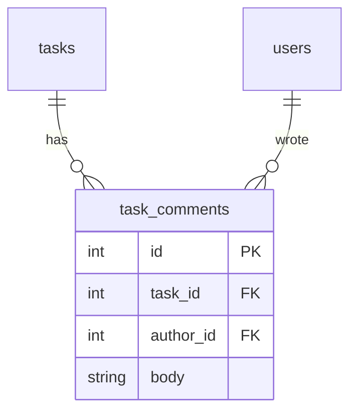
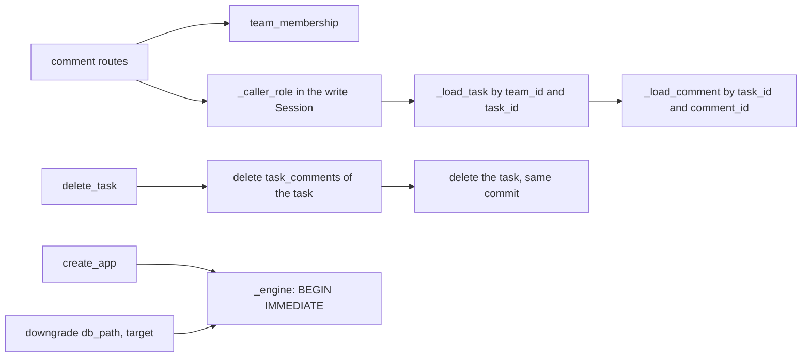

# PRD-019: teamtasks task comments

**Status**: Implemented
**Date**: 2026-10-25
**Author**: AI-assisted
**Priority**: P2
**Depends on**: PRD-017
**Supersedes**: None

> **Pilot note.** Change 10 of the specforge v2 pilot, the last one, built with the v1 workflow. It adds the first table that hangs off `tasks`, so it is also the first change where deleting a task has to delete something else.

## Impacted Projects

| Project | Impact |
|---------|--------|
| **teamtasks** | New table `task_comments` (new) and migration `0004_task_comments` (new) with a guarded downgrade. Three new routes under `/teams/{team_id}/tasks/{task_id}/comments`. `DELETE` of a task also deletes its comments. Pins of the head revision in the tests move to `0004`. `docs/SYSTEM_ARTIFACT.md` tasks domain. |

---

## 1. Problem Statement

A team can create and update tasks (`../specforge-pilot/teamtasks/app.py:547-559`, `:622-635`), but nobody can say anything about one: there is no place for a question, a decision or a status note. There is no usage evidence. The pilot backlog orders this change tenth.

What is established:
- **Deletion.** Deleting a task deletes only the task row (`../specforge-pilot/teamtasks/app.py:637-645`). SQLite's foreign keys are not enforced (`PRAGMA foreign_keys` is off, `../specforge-pilot/docs/SYSTEM_ARTIFACT.md:127`), so a child row is orphaned unless the code deletes it.
- **Removal.** Removing a member clears only their assignments and leaves the rest of their work in place (`../specforge-pilot/teamtasks/app.py:473-474`).
- **Role checks.** Every write route re-reads the caller's role under the database lock (`_caller_role`, `../specforge-pilot/teamtasks/app.py:366-371`).
- **Revision pins.** The head revision is pinned in five test lines: `../specforge-pilot/tests/test_roles.py:357`, `:517`, `:525`, `:551` and `../specforge-pilot/tests/test_task_statuses.py:217`.

What is assumed: a member reads comments a page at a time, so the list needs the same paging bounds as the task list.

## 2. Goals

- When a member posts `{body}` to a task of their team, the system shall store the comment with the caller as author and return it with `201`.
- When a member lists a task's comments, the system shall return them in id order, paged with the task list's `limit` and `offset` bounds.
- When the comment's author, the team's owner or an admin deletes a comment, the system shall delete it with `204`. If anyone else tries, then the system shall answer `403` and keep the comment.
- When a task is deleted, the system shall delete its comments in the same transaction.
- If the downgrade of `0004_task_comments` finds any comment, then it shall refuse with a `RuntimeError` naming the count and change nothing.

**Appetite**: under 100 lines of product code, one migration, no new dependency, one implementation round.

## 3. Non-Goals

- **Editing a comment.** A comment is deleted and re-posted instead.
- **Mentions, notifications, reactions, attachments or threading.**
- **Searching or exporting comments.** PRD-018's export is unchanged.
- **Logging who commented or deleted what.** [PRD-016](016-teamtasks-team-audit-log.md) owns team logging.
- **Showing an author's email.** A comment carries `author_id` only (§8 row 4).

## 4. User Flows / Design

1. The actor is a logged-in member of the task's team. Every call carries a bearer token.
2. Posting, listing and deleting are each one request against a task id the member already has from the task list.
3. A removed member's comments stay, with their `author_id`. The owner or an admin can delete them.
4. No design exists; this PRD adds no user interface.

```mermaid
sequenceDiagram
    participant M as Member
    participant API as teamtasks
    participant DB as SQLite

    M->>API: POST /teams/1/tasks/7/comments {body}
    API->>DB: current_user, then team_membership (401 / 422 team_id / 404 before any read)
    API->>API: validate task_id and the body (422)
    API->>DB: Session: re-read the caller's role; load task 7 of team 1
    alt caller gone
        API-->>M: 404 team not found
    else task not in team 1
        API-->>M: 404 task not found
    else
        API->>DB: INSERT task_comments; commit
        API-->>M: 201 {id, task_id, author_id, body}
    end
```

### 4.1 Happy path

1. A member posts `{"body": "Blocked on the API key"}` to `/teams/1/tasks/7/comments` and gets `201 {"id": 1, "task_id": 7, "author_id": 2, "body": "Blocked on the API key"}`.
2. Any member lists `/teams/1/tasks/7/comments` and gets `[{"id": 1, ...}]`.
3. The author deletes `/teams/1/tasks/7/comments/1` and gets `204`. The list is empty.

### 4.2 Error branches

| # | Branch | Status | Body |
|---|--------|--------|------|
| 1 | No or unknown token | 401 | `{"detail": "invalid token"}` |
| 2 | `team_id` not an integer in 1..2^63-1, or a body that is not well-formed JSON | 422 | validation error |
| 3 | Caller not a member, or no such team | 404 | `{"detail": "team not found"}` |
| 3a | For a member: `task_id` or `comment_id` not an integer in 1..2^63-1, `limit` or `offset` out of range | 422 | validation error |
| 4 | Body missing, empty after trimming, over 2,000 characters, with a control character other than `\n`, with a bidi character, or with an extra field | 422 | validation error |
| 5 | Task not in this team, or no such task | 404 | `{"detail": "task not found"}` |
| 6 | Comment not on this task, or no such comment | 404 | `{"detail": "comment not found"}` |
| 7 | A member deletes a comment they did not write | 403 | `{"detail": "only the author, the owner or an admin can delete a comment"}` |
| 8 | The caller is removed or demoted between `team_membership` and a write | 404 or 403 | as rows 3 and 7, decided on the role re-read in the write's Session |
| 9 | The caller is removed between `team_membership` and the list's read | 200 | one more read, the accepted read debt (`SYSTEM_ARTIFACT.md`, teams Open Debt) |
| 10 | The database lock is not acquired within 5 s | 500 | FastAPI's default |

## Frontend Spec

No design exists: this PRD adds no user-visible screen. The surface is three JSON routes.

## 5. API

All three routes depend on `team_membership` (`../specforge-pilot/teamtasks/app.py:339-346`), so a non-member gets `404 team not found` before any other refusal except a bad `team_id` and a body that is not well-formed JSON, both of which FastAPI rejects first. FastAPI validates `team_id` as the dependency's own parameter, and the endpoint's `task_id`, `comment_id`, query and body only after the dependency has run. `task_id` and `comment_id` use `TeamId`'s bounds (`../specforge-pilot/teamtasks/app.py:111`). A task is always loaded by both `team_id` and `task_id` through `_load_task` (`../specforge-pilot/teamtasks/app.py:531-535`). A comment is always loaded by both `task_id` and `comment_id`, so an id from another task or team is `404 comment not found`, the same as a comment that does not exist.

### 5.1 `POST /teams/{team_id}/tasks/{task_id}/comments` (new)

**Body**: `NewComment` (new), `extra="forbid"`, with one field `body: CommentBody` (new).
- `CommentBody` is stripped, 1 to 2,000 characters.
- It rejects any `Cc` character except `\n`, and any character in `BIDI` (`../specforge-pilot/teamtasks/app.py:102`), through `_no_control_chars_but_newline` (new).

**Order of checks**: 401 → 422 `team_id` → 404 team → 422 `task_id` / body → in the Session, `_caller_role` (404 team) → `_load_task` (404 task) → insert.

**Response 201**: `{"id", "task_id", "author_id", "body"}`. `author_id` is the caller and is never read from the body.

### 5.2 `GET /teams/{team_id}/tasks/{task_id}/comments` (new)

**Query**: `limit` 1..100, optional; without it, every comment. `offset` 0..2^63-1, default 0. The bounds are the same as `list_tasks` (`../specforge-pilot/teamtasks/app.py:565-566`).

**Order of checks**: 401 → 422 `team_id` → 404 team → 422 `task_id` / `limit` / `offset` → 404 task → 200.

**Response 200**: the task's comments in id order, each as in §5.1.

### 5.3 `DELETE /teams/{team_id}/tasks/{task_id}/comments/{comment_id}` (new)

**Rule**: allowed to the comment's author and to the team's owner and admins. Anyone else gets `403 only the author, the owner or an admin can delete a comment`. The rule mirrors `delete_task` (`../specforge-pilot/teamtasks/app.py:642-643`).

**Order of checks**: 401 → 422 `team_id` → 404 team → 422 `task_id` / `comment_id` → in the Session, `_caller_role` (404 team) → `_load_task` (404 task) → `_load_comment` (new, 404 comment) → 403 → delete.

**Response**: `204`, no body.

### 5.4 `DELETE /teams/{team_id}/tasks/{task_id}` (changed)

The existing route (`../specforge-pilot/teamtasks/app.py:637-645`) keeps its checks and messages. In the same Session and commit, it also deletes every `task_comments` row whose `task_id` is the deleted task.

## 6. Data Model

### 6.1 `task_comments` (new)

| Column | Type | Constraint |
|--------|------|-----------|
| `id` | int | primary key |
| `task_id` | int | not null; FK `tasks.id`, declared only (foreign keys are off); indexed by `ix_task_comments_task_id` (new) |
| `author_id` | int | not null; FK `users.id`, declared only |
| `body` | str(2000) | not null |

There is no `team_id`: a comment is reached only through `_load_task`, which already scopes by team. Declaring the FKs matches `tasks` (`../specforge-pilot/teamtasks/app.py:95-99`) and keeps `tests/test_roles.py` row 13 (`compare_metadata == []`, `../specforge-pilot/tests/test_roles.py:392-404`) meaningful.



### 6.2 Migration `0004_task_comments` (new)

- `down_revision = "0003_task_statuses"` (`../specforge-pilot/teamtasks/migrations/versions/0003_task_statuses.py:6`).
- **Upgrade:** creates the table and its index. It runs through the existing `_migrate` (`../specforge-pilot/teamtasks/app.py:247-262`). `BASELINE_TABLES` (`:244`) is unchanged.
- **Downgrade:** counts the rows of `task_comments`.
  - With any row, it raises `RuntimeError("cannot downgrade: N comment(s) exist")` and changes nothing (decided by the human, 2026-10-25).
  - With none, it drops the index and the table.
  - This is the same guard shape as `0003`'s downgrade (`../specforge-pilot/teamtasks/migrations/versions/0003_task_statuses.py:27-31`).
- **Head-revision pins:** the five pins listed in §1 change from `0003_task_statuses` to `0004_task_comments`.
- **Transactional downgrade:** the `downgrade` helper of `../specforge-pilot/tests/test_task_statuses.py:191-200` becomes a call to `teamtasks.app.downgrade` (§7). Its plain `create_engine(...).begin()` lacks the app's `BEGIN IMMEDIATE`, so pysqlite autocommits DDL. A downgrade from `0004` refused at `0003`'s guard would leave the database at `0004` with `task_comments` dropped. Reproduced in the draft review.
- These, the new rows, and row 13's new assertions inside the existing `test_12` are the only edits to existing tests.

## 7. Architecture

All of it lives in `teamtasks/app.py` and the new migration file.



- **Write routes.** `create_comment` and `delete_comment` (both new) open one Session. They call `_caller_role` first, then `_load_task`, then for a delete `_load_comment` and the 403 rule, then write and commit. This is the same shape as `update_task` and `delete_task`.
- **Reads.** `list_comments` (new) decides membership on the dependency, like every read route.
- **Task delete.** `delete_task` adds one `delete(TaskComment).where(TaskComment.task_id == task.id)` before `db.delete(task)`, in the same commit.
- **Shared output.** `_comment_out` (new) is the one place the response shape is built.
- **Engine and downgrade.** `_engine(db_path)` (new) builds the engine with `hide_parameters=True` and the two listeners now inline in `create_app` (`../specforge-pilot/teamtasks/app.py:266-274`), and `create_app` uses it. `downgrade(db_path, target)` (new) runs `alembic.command.downgrade` on a `_engine(db_path).begin()` connection with the same Config as `_migrate`. A refused guard anywhere in a multi-revision chain then rolls back every step, DDL and version row included (verified by the mechanism bounce, 2026-10-25).
- **Model.** `TaskComment` (new) declares `task_id` with `index=True`, which yields the name `ix_task_comments_task_id`, so the model and `0004` compare equal in `tests/test_roles.py` row 13.

**Rejected:**
- Turning on `PRAGMA foreign_keys` with `ON DELETE CASCADE`. It is a cross-cutting change to every table and every existing delete, and the SA's debt line says no change may assume it.
- A soft delete (`deleted_at`). Nothing reads deleted comments, and a soft-deleted body is still stored PII-adjacent text.
- Storing `team_id` on the comment. It duplicates what `_load_task` already enforces and adds a second value that could disagree with the task's.
- Returning the author's email. It would add a fourth place emails are shown, with the consent debt of PRD-015 §8 row 7.

## 8. Security

| # | Threat | Mitigation | Enforced at |
|---|--------|------------|-------------|
| 1 | A non-member reads or writes a team's comments | `team_membership` answers 404 before any read or body validation | §5 |
| 2 | A comment id or task id from another team or task is used to read or delete (IDOR) | the task is loaded by `team_id` and `task_id`, and the comment by `task_id` and `comment_id`; a miss is a 404, identical to a missing row | §5, §7 |
| 3 | A member deletes another member's comment; an admin demoted mid-request still deletes | author, owner or admin only; the role is re-read with `_caller_role` inside the write's Session | §5.3, §7 |
| 4 | The comment list leaks member emails | the response carries `author_id` only | §5.1, §7 |
| 5 | Control, bidi or terminal escape characters in a body spoof how it displays; invisible characters carry a hidden payload | `CommentBody` rejects `Cc` except `\n`, and every `BIDI` character. **Not closed:** other format characters (`Cf`, tag characters U+E0000-E007F), the 256 variation selectors and default-ignorable fillers pass, so a body can carry text a reader cannot see. A closed denylist was refuted in the draft bounce. Recorded in §11 (decided by the human, 2026-10-25) | §5.1 |
| 6 | `author_id` is forged | it is taken from the caller; `extra="forbid"` rejects a body field | §5.1 |
| 7 | Orphaned comments of a deleted task attach to the next task that gets its id, in any team: `tasks.id` has no `AUTOINCREMENT` (`../specforge-pilot/teamtasks/app.py:94`), so SQLite reuses a deleted maximum id, and a comment is reached only through `task_id` | `delete_task` deletes them in the same commit. This is the only barrier, so every future path that deletes a task must do the same (SYSTEM_ARTIFACT invariant) | §5.4 |
| 8 | Inherited: a removed member gets one more list read; the default 422 handler echoes the submitted body to its own sender; deletes are unaudited | unchanged. The echo returns only what the sender just sent. Auditing is PRD-016 | — |

**Secrets**: none. **PII**: comment bodies are free text a member may fill with personal data. They are visible to every current and future member of the team. They can be deleted by the author while still a member, or by the owner or an admin; a departed author cannot delete their own comments (accepted debt, decided by the human, 2026-10-25). Retention: a comment is kept until it or its task is deleted.

## 9. Test Plan

| # | Test | Type | Description | Path |
|---|------|------|-------------|------|
| 1 | a member comments and lists | integration | ben posts `Blocked on the API key` to task 1 of team A and gets `201` with `author_id` ben and the trimmed body. ana lists it. Two more comments list in id order. | `../specforge-pilot/tests/test_task_comments.py` |
| 2 | a non-member is refused first; no token is 401 | integration | On all three routes, dee gets `404 team not found`, identical to a missing team, even with an empty body; no token gets `401`. Fails against validating the body before `team_membership`. | `../specforge-pilot/tests/test_task_comments.py` |
| 3 | a task or comment from elsewhere is 404 | integration | A task id of team B on team A's path is `404 task not found` on all three routes. A comment id of another task of the same team, on `DELETE`, is `404 comment not found` and that comment survives. Fails against loading the comment by `comment_id` alone. | `../specforge-pilot/tests/test_task_comments.py` |
| 4 | body rules | integration | `""`, `"   "`, 2,001 characters, `a\u0007b`, `a\tb`, `a\rb`, `a\u202eb`, `null`, `123` and `{"body": "x", "author_id": 9}` are 422. `"line one\nline two"`, exactly 2,000 characters, and 2,000 characters wrapped in spaces are 201. Nothing is stored for a 422. Fails against `_no_control_chars` reused as is (it rejects `\n`) and against a model without `extra="forbid"`. | `../specforge-pilot/tests/test_task_comments.py` |
| 5 | delete by role | integration | ben deletes his own comment (`204`). cy, a plain member, gets `403` with the message on ben's comment, and it survives. ana (owner) and ada (admin) each delete one of ben's comments (`204`). | `../specforge-pilot/tests/test_task_comments.py` |
| 6 | a role change after the dependency is judged at the write | integration | With `run_with_hook`, imported from `tests/test_roles.py` with its `w` fixture: ada demoted to member between the dependency and the Session gets `403` on deleting ben's comment; ben removed gets `404 team not found` on posting and on deleting his own comment. Each case queries `task_comments` directly afterwards, because the hook's snapshot covers only `memberships` and `tasks`; the comment survives and nothing is stored. Fails against trusting the dependency's role. | `../specforge-pilot/tests/test_task_comments.py` |
| 7 | deleting a task deletes its comments, and a reused id starts empty | integration | Team A's highest-id task, with two comments, is deleted; another task's comment remains. A task created next in team B gets the same id, and its comment list is `[]`. Fails against `delete_task` deleting only the task row, where team B would read team A's comments. | `../specforge-pilot/tests/test_task_comments.py` |
| 8 | a removed member's comments stay | integration | ben comments, then is removed. The list still shows his comment with his `author_id`, and ana can delete it. | `../specforge-pilot/tests/test_task_comments.py` |
| 9 | paging and path bounds | integration | With 5 comments: `limit=2&offset=1` returns the 2nd and 3rd. For a member, `limit=0`, `limit=101`, `offset=-1`, and a `team_id`, `task_id` or `comment_id` of `0` or `2**63` on each route that takes it, are 422, never 500. Fails against a `comment_id` typed as a plain `int`, which reaches the SQLite binding and answers 500. | `../specforge-pilot/tests/test_task_comments.py` |
| 10 | the migration upgrades an existing database | integration | A pre-Alembic `legacy_db` (`../specforge-pilot/tests/test_roles.py:316-343`), migrated by `create_app` is at `0004_task_comments`, with `task_comments` and `ix_task_comments_task_id` present. The existing task is unchanged. | `../specforge-pilot/tests/test_task_comments.py` |
| 11 | the guarded downgrade | integration | Using the `downgrade` helper of `tests/test_task_statuses.py` with target `0003_task_statuses`: with one comment, it raises a `RuntimeError` containing `1 comment(s)`. `sqlite_master` and the comment rows are unchanged. After the comment is deleted, the downgrade drops the table and the version is `0003_task_statuses`. Fails against a downgrade that drops before counting. | `../specforge-pilot/tests/test_task_comments.py` |
| 12 | the migrations still match the models, at the new head | integration | `tests/test_roles.py` rows 12, 13, 20, 21 and 22, and `tests/test_task_statuses.py` row 12, pass with their pins at `0004_task_comments`. | `../specforge-pilot/tests/test_roles.py` |
| 13 | a refused downgrade through the new head changes nothing | integration | `tests/test_task_statuses.py` row 12, with its helper calling `teamtasks.app.downgrade` and its pin at `0004_task_comments`: with a task in `review` and no comments, the downgrade to `0002` refuses at `0003`'s guard, `sqlite_master` is identical before and after, and the version is still `0004_task_comments` with `task_comments` present. Fails against the old plain-engine helper, which leaves `task_comments` dropped. | `../specforge-pilot/tests/test_task_statuses.py` |
| 14 | a refused or failed task delete keeps its comments | integration | cy, a plain member who did not create the task, gets `403` deleting a task with comments, and both comments remain. With `Session.delete` monkeypatched to raise, a delete by the owner raises and both the task and its comments remain. Fails against deleting the comments before the 403 check, or in a commit of their own. | `../specforge-pilot/tests/test_task_comments.py` |
| 15 | the previous commit refuses a database at 0004 | integration | The `teamtasks/` tree of the commit before the one that adds `0004` (HEAD while uncommitted), extracted with `git archive` as in `../specforge-pilot/tests/test_task_statuses.py:176-189`, raises `CommandError` with `Can't locate revision` on a database migrated to `0004`. This proves §10's rollback order. Like `previous_app`, it relies on git history: after commit, `--diff-filter=A` must return exactly one hash for the `0004` file. | `../specforge-pilot/tests/test_task_comments.py` |

## 10. Migration Plan

1. **Deploy.** Deploying the commit runs `0004_task_comments` at startup through `_migrate`, creating an empty table. The existing routes are unchanged except for §5.4.
2. **Rollback.**
   1. Delete every comment, a human decision since it destroys data.
   2. Stop the app, so no comment is posted between the guard's count and the drop. Then, from the repository root, run `TEAMTASKS_DB=<path> uv run python -c "from teamtasks.app import downgrade; downgrade('<path>', '0003_task_statuses')"`. `TEAMTASKS_DB` must equal `<path>`: importing `teamtasks.app` runs `create_app` on that variable (`../specforge-pilot/teamtasks/app.py:650`), and unset it creates and migrates a stray `teamtasks.db` in the working directory. Pre-check: `SELECT count(*) FROM task_comments` must be `0`, or the downgrade refuses.
   3. Deploy the previous commit.

   The previous commit refuses to start on a database at `0004` (SYSTEM_ARTIFACT.md, Database and migrations).
3. **Flag.** No flag: the routes are new and unused until called.
4. **Smoke check after deploy.** As a member, `curl -s -o /dev/null -w '%{http_code}' -H 'Authorization: Bearer <token>' <host>/teams/<id>/tasks/<task id>/comments` prints `200`.

## Observability

No new log line; [PRD-016](016-teamtasks-team-audit-log.md) owns team logging.
- **Startup.** It logs `schema at 0004_task_comments` on `uvicorn.error` (`../specforge-pilot/teamtasks/app.py:277`), which is how an operator confirms the migration ran.
- **Requests.** uvicorn's access log on stdout records each comment request with its status, so a burst of `403`s or `500`s on `/comments` is visible there by hand.
- **Not recorded.** Who deleted whose comment is not recorded, the same gap PRD-016 owns for every team action.
- **Check after deploy.** `SELECT count(*) FROM task_comments c LEFT JOIN tasks t ON t.id = c.task_id WHERE t.id IS NULL` must be `0`, and the access log must show no `5xx` on `/comments`. Any orphan means a task was deleted by a path that skipped §5.4, and it is readable by whichever task reuses the id. The pilot lead runs both by hand; nothing pages anyone.

## 11. Open Questions

- [ ] There is no limit on the number of comments per task or per member, and no rate limit. Cost: one member can fill a task's list; the list's paging bounds each response but not storage. Revisit with usage data.
- [ ] Deletes are unaudited until PRD-016. Cost: an owner or admin can remove a member's comment without a trace.
- [ ] Invisible characters (`Cf`, variation selectors, fillers) pass `CommentBody`. Cost: a comment can carry a payload no member sees, which matters the day an LLM or agent reads comments. Close it with a category rule before that day.
- [ ] A departed author cannot delete their own comments; a comment is kept until it or its task is deleted. Cost: personal data in a comment outlives its author's membership. Accepted debt.
- [ ] An unpaged `GET` returns every comment of a task. Cost: one member posting many 2,000-character comments makes each unpaged list large. Revisit with the per-task cap above.
- [ ] Rollback destroys every comment. Cost: a rollback after real use loses discussion history; §10 makes it an explicit human step.

## Clarifications

- 2026-10-25 — How does the `0004` downgrade behave when comments exist? → §6.2.
- 2026-10-25 — Can an author who left the team delete their comments? → §8 PII.

---

## Gate: Promotion to Implemented

```yaml
commit_hash: 650b3cf
tests:
  - ../specforge-pilot/tests/test_task_comments.py
  - ../specforge-pilot/tests/test_roles.py
  - ../specforge-pilot/tests/test_task_statuses.py
system_artifact_diff:
  - ../specforge-pilot/docs/SYSTEM_ARTIFACT.md#domain-tasks (commit 643005b)
```
